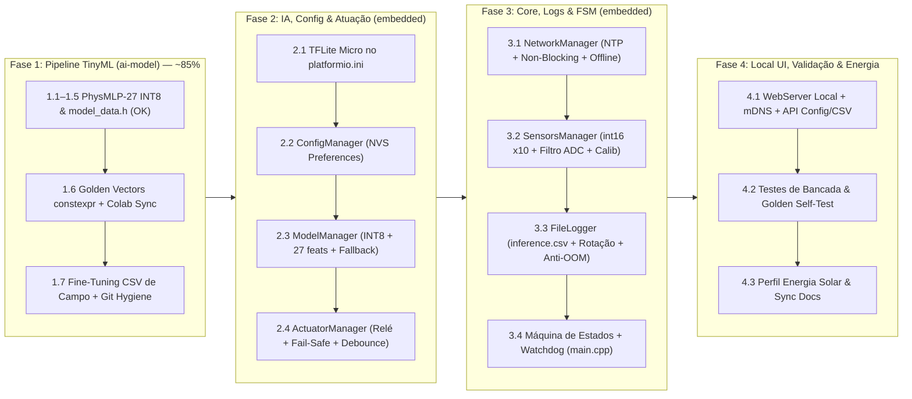

# Plano de Ação e Implementação: Modelo TinyML & Firmware ESP32

> **Escopo deste Documento:** Diagnóstico técnico atualizado das entregas já realizadas, das divergências entre documentação e código-fonte e das lacunas técnicas remanescentes, seguido do plano de implementação estruturado exclusivamente para o **Modelo de IA Embarcada (`ai-model/`)** e o **Firmware ESP32 (`embedded/`)** (excluindo o diretório `web/`).
>
> **Última auditoria contra o repositório:** Sincronizado com `ai-model/train_tinyml_v2.py`, `ai-model/output/train_tinyml_v2_report.json`, `docs/AUDITORIA_TINYML_E_COMPARATIVO.md`, `embedded/include/model_data.h` e o código atual de `embedded/`.

---

## Resumo Executivo de Progresso

| Frente / Fase | Status Atual | Resumo Objetivo |
| :--- | :---: | :--- |
| **Fase 1 — Pipeline TinyML (`ai-model/`)** | **~85% Concluída** | Modelo `PhysMLP-27` Full INT8 (`5.480 B`) treinado, auditado em 8 modos + `GroupSplit` e exportado para `embedded/include/model_data.h`. Restam ajustes de fechamento (Golden Vectors em `constexpr`, modo *fine-tuning* com CSV de campo, sincronia do notebook Colab e commit/limpeza). |
| **Fase 2 — IA, Config & Atuação (`embedded/`)** | **~15% Concluída** | Apenas `embedded/include/model_data.h` existe. Faltam dependência TFLite Micro no `platformio.ini`, `ConfigManager` (NVS), `ModelManager` (INT8 + 27 features + sentinelas) e `ActuatorManager` (relé *fail-safe*, *timeout*, *cooldown*, histerese). |
| **Fase 3 — Core, Logs & FSM (`embedded/`)** | **~30% Concluída** | Base estrutural de `SensorsManager`, `FileLogger`, `NetworkManager` e `main.cpp` existe, mas apresenta bugs e lacunas críticas: ausência de NTP, reconexão Wi-Fi bloqueante (15s), sub-rede inválida em `config.h`, temperatura `int8_t` (`-128`), falta de rotação/OOM no LittleFS e máquina de estados inativa. |
| **Fase 4 — Interface Local, Testes & Energia** | **~10% Concluída** | Há `embedded/view/index.html` + `scripts/gzip_data.py` gerando `index.html.gz`, porém `WebServer` e `ESPmDNS` não estão instanciados. Faltam testes de bancada (*Golden Vectors Self-Test*), Watchdog (`esp_task_wdt`), diretrizes para painel solar e sincronização de `docs/TODO.md` / `README.md`. |

---

## 1. Diagnóstico Real do Repositório (Auditoria Código vs Documentação)

A inspeção completa do repositório revelou dois problemas paralelos:
1. **Avanço real em `ai-model/` ainda não refletido nos documentos antigos:** A versão anterior deste plano e o `README.md` ainda citavam um script `ai-model/train_tinyml.py` com dados sintéticos lineares que **não existe mais**. O pipeline real evoluiu para `ai-model/train_tinyml_v2.py` (`PhysMLP-27` Full INT8), acompanhado por benchmark de 10 arquiteturas (`benchmark_architectures.py`) e 12 gráficos científicos (`generate_plots.py`).
2. **Divergências `[x]` em `docs/TODO.md` vs implementação real em `embedded/`:** Diversos itens marcados como concluídos no `TODO.md` (Máquina de Estados, NTP, temperatura ponto fixo `int16_t`, calibração persistente, WebServer local, mDNS) estão ausentes ou incompletos no código C++.

### 1.1. Estado Atual e Lacunas no Modelo de IA (`ai-model/`)

#### O que já foi implementado e validado no repositório
* **Artefatos presentes:**
  - `ai-model/train_tinyml_v2.py` — Pipeline completo v2 reproduzível (`SEED = 42`).
  - `ai-model/train_tinyml_v2_colab.ipynb` — Notebook Colab v2 alinhado à auditoria (coexiste com o legado `ai-model/train_tinyml_colab.ipynb`).
  - `ai-model/benchmark_architectures.py` e `ai-model/generate_plots.py` — Benchmark de 10 arquiteturas (7 neurais + 3 árvores) e geração de 12 pranchas em `ai-model/output/figures/fig01..fig12.png` + `train_tinyml_v2_diagnostics.png`.
  - `docs/AUDITORIA_TINYML_E_COMPARATIVO.md` — Relatório forense com os 9 bugs identificados na v1 e justificativa experimental da arquitetura `PhysMLP-27`.
  - `ai-model/output/model_int8.tflite` (`5.480 B`), `ai-model/output/model_float32.tflite` (`8.216 B`), `ai-model/output/train_tinyml_v2_report.json` e `ai-model/output/benchmark_summary.json`.
  - `ai-model/model_data.h`, `ai-model/output/model_data.h` e **`embedded/include/model_data.h`** — Todos sincronizados bit-a-bit (`620` linhas), contendo `g_model_data[]`, `g_model_len`, constantes de normalização/psicrometria, escalas INT8, sentinelas, enums C++ e funções inline (`isValidSensorReading`, `computeVpdKpa`, `encodeFeatures27`, `quantizeInput`, `dequantizeOutput`).

* **Especificação técnica verificada do modelo atual (`PhysMLP-27` v2 INT8):**
  - **Dataset:** `ai-model/datasets/Smart Agriculture Dataset/cropdata_updated.csv` (`16.411` registros $\rightarrow$ **`16.283` únicos** após remoção de `128` duplicatas exatas; `2.886` tuplas físicas únicas `(MOI, temp, humidity)`).
  - **Entradas (`27` features `float32` quantizadas para `int8`):**
    - `[0..2]`: `temp` (`[0..50 °C]`), `humidity` (`[0..100 %]`), `soilMoisture` (`[0..100 %]`) normalizados em `[0, 1]`.
    - `[3..9]`: *One-Hot* `soil_type` (`7` solos; `0 = UNKNOWN` $\rightarrow$ vetor zero).
    - `[10..14]`: *One-Hot* `crop ID` (`5` culturas; `0 = UNKNOWN` $\rightarrow$ fallback hortaliças locais).
    - `[15..22]`: *One-Hot* `Seedling Stage` (`8` estágios; `0 = UNKNOWN` $\rightarrow$ vetor zero).
    - `[23..26]`: **4 features psicrométricas/hidrotérmicas** (`VPD_norm` via equação de Tetens, `EvapDemand`, `Temp/MOI ratio`, `MOI * Temp` coupling).
  - **Arquitetura e Treino:** `Input(27) -> Dense(32, ReLU) -> Dense(16, ReLU) -> Dense(3, Softmax)`, *Full-8 Mask Context Dropout* (cobrindo todas as $2^3 = 8$ combinações de contexto, incluindo o Modo 6 `[0, C, 0]`), validação limpa (`is_training=False`), `EarlyStopping` + `ReduceLROnPlateau` e pesos calibrados `{0: 1.0, 1: 1.15, 2: 2.20}` (evitando o colapso de Precisão da Classe 2 causado por `class_weight="balanced"`).
  - **Quantização e Grafo TFLite verificados (`model_int8.tflite`):**
    - Tamanho: **`5.480 bytes`** (`5,35 KB`, redução de `33,3%` frente aos `8.216 B` Float32).
    - Tensores: `11` tensores; Entrada `[1, 27]` (`int8`, `scale = 3.92156886e-03`, `zero_point = -128`); Saída `[1, 3]` (`int8`, `scale = 3.90625000e-03`, `zero_point = -128`).
    - Operadores reais do grafo: **3x `FULLY_CONNECTED`** (com ReLU fundido) + **1x `SOFTMAX`**.
    - Fidelidade Keras Float32 vs TFLite INT8: concordância de decisão **`98,50%`**, `mean_abs_diff = 0,0066`, `max_abs_diff = 0,2135` (em amostras na fronteira de decisão Softmax).
  - **Métricas reais registradas em `train_tinyml_v2_report.json`:**

| Cenário de Avaliação | Split Estratificado (70/15/15) | GroupSplit Estrito (0% *Sensor-Tuple Leakage*) |
| :--- | :---: | :---: |
| **M1: Completo `[S, C, St]`** | Acc `98,20%` \| Macro-F1 `95,29%` \| ECE `0,0054` | Acc `97,43%` \| Macro-F1 `93,99%` \| ECE `0,0026` |
| **M4: Cultura+Estágio `[0, C, St]`** | Acc `97,26%` \| Macro-F1 `93,01%` \| ECE `0,0064` | — |
| **M5: Apenas Solo `[S, 0, 0]`** | Acc `90,34%` \| Macro-F1 `78,14%` \| ECE `0,0144` | — |
| **M6: Apenas Cultura `[0, C, 0]`** | Acc `89,28%` \| Macro-F1 `76,85%` \| ECE `0,0128` | Acc `87,30%` \| Macro-F1 `74,85%` \| ECE `0,0125` |
| **M8: Zero Contexto `[0, 0, 0]`** | Acc `90,54%` \| Macro-F1 `76,84%` \| ECE `0,0171` | Acc `86,56%` \| Macro-F1 `74,88%` \| ECE `0,0323` |

#### Lacunas remanescentes em `ai-model/`
1. **Empate no Golden Vector Caso 3 sob Quantização INT8 (`[Atenção Crítica]`):**
   - Em `embedded/include/model_data.h` (linha 16), o Caso 3 (*Sem Contexto — `38 °C`, `40% RH`, `75% Solo`*, cenário típico de estresse térmico com solo encharcado) resultou em **`P0 = 0,434`, `P1 = 0,129`, `P2 = 0,434`**, e o `argmax` retornou `Class = 0 (OFF)` por empate numérico. Isso comprova que o fallback físico complementar no `ModelManager` **não pode atuar apenas quando a rede prevê `IRRIGATE`**, precisando também promover `OFF` para `THERMAL_STRESS_WET_SOIL` quando `soilMoisture >= 65%`, `temp >= 32 °C` e `P(2)` atingir limiar de alerta (ex: `>= 0,40`).
2. **Golden Test Vectors apenas em comentários (`[Pendente]`):**
   - Os 6 casos de teste estão comentados no topo de `model_data.h`, sem structs `constexpr` compiláveis para que o ESP32 execute um *self-test* automatizado no boot verificando a fidelidade do TFLM embarcado contra o `tf.lite.Interpreter`.
3. **Ausência de Pipeline de Re-treinamento (*Fine-Tuning*) com Dados de Campo (`[Pendente]`):**
   - `train_tinyml_v2.py` carrega exclusivamente `cropdata_updated.csv`. Ainda não possui CLI/rotina para ingerir os logs coletados em Paulista-PE (`/littlefs/readings.csv` + `/littlefs/inference.csv`), validar rótulos/sentinelas e executar *fine-tuning* incremental.
4. **Desalinhamento entre `train_tinyml_colab.ipynb` e `train_tinyml_v2.py` (`[Divergência]`):**
   - O notebook Colab gera um `model_data.h` simplificado (sem `encodeFeatures27`, `computeVpdKpa`, `quantizeInput`/`dequantizeOutput`, `INPUT_SCALE`/`ZERO_POINT` e enums C++), usa `X_train[:300]` sequencial no `representative_data_gen()` (em vez de amostragem estratificada nos 8 modos) e não copia o header para `embedded/include/model_data.h`.
5. **Pendências de Versionamento e Higiene do Repositório (`[Organização]`):**
   - `ai-model/train_tinyml_v2.py`, `embedded/include/model_data.h`, `ai-model/output/model_int8.tflite`, `ai-model/output/model_float32.tflite` e `ai-model/output/train_tinyml_v2_report.json` estão sem commit no Git (`untracked` / `modified`).
   - A figura `ai-model/output/figures/train_tinyml_v2_diagnostics.png` não foi gerada na execução anterior (ausência de `matplotlib` no interpretador utilizado).
   - O relatório de auditoria está duplicado em `ai-model/auditoria_tinyml_e_comparativo.md` e `docs/AUDITORIA_TINYML_E_COMPARATIVO.md` (definir `docs/AUDITORIA_TINYML_E_COMPARATIVO.md` como fonte única).

---

### 1.2. Estado Atual e Lacunas no Firmware Embarcado (`embedded/`)

1. **Módulo de Inteligência Artificial `ModelManager` Inexistente (`[Pendente Crítico]`):**
   - `embedded/include/model_data.h` **já existe** (`PhysMLP-27` INT8, 27 features), porém ainda não existem `embedded/include/ModelManager.h` nem `embedded/src/ModelManager.cpp`.
   - Nenhuma biblioteca de inferência TensorFlow Lite Micro está declarada em `embedded/platformio.ini` (apenas `DHT sensor library` e `WiFiManager`).
   - Como o modelo atual é **Full INT8 (`tf.int8` entrada/saída)** com **27 features**, o `ModelManager` precisa chamar `TinyMLConfig::isValidSensorReading()`, `encodeFeatures27()`, `quantizeInput()`, invocar o interpretador com `tensor_arena` alinhada (`alignas(16)`) e desquantizar as 3 saídas via `dequantizeOutput()` — além de aplicar o fallback físico de estresse térmico.
2. **Módulo de Atuação `ActuatorManager` Inexistente e Risco de Polaridade de Relé (`[Pendente Crítico]`):**
   - O controle do relé está hardcoded em `embedded/src/main.cpp` (linhas 85–91) com regra estática `if (data.soilMoisture < 30 && data.soilMoisture > 0)`.
   - Não existe parametrização de polaridade do relé (`RELAY_ACTIVE_LOW` vs `Active-HIGH`) em `config.h`: muitos módulos relé comerciais acionam com `LOW`, o que faria a válvula **abrir acidentalmente no boot ou em `emergencyStop()`**.
   - Faltam proteções hidráulicas/elétricas não-bloqueantes: tempo máximo contínuo de rega (*timeout*), tempo mínimo de infiltração entre regas (*cooldown*), confirmação por múltiplas leituras consecutivas (**anti-*chattering*** contra ruído na fronteira de decisão) e desligamento de emergência (*fail-safe*).
3. **Módulo de Persistência de Configurações (`ConfigManager`) Inexistente (`[Pendente Crítico]`):**
   - O `docs/TODO.md` marca `[x]` para *"salvar configurações de calibração sem precisar regravar o firmware"*, mas não existe nenhum armazenamento em NVS (`Preferences`) nem em `LittleFS` para persistir o contexto agronômico (`soilType`, `cropId`, `seedlingStage`), limiares (`confidenceThreshold`, `thermalStressThreshold`), calibração do ADC (`SOIL_ADC_DRY`, `SOIL_ADC_WET`) e parâmetros de segurança da válvula.
4. **Máquina de Estados (`SystemState`) Inativa e Ausência de Watchdog (`[Divergência TODO vs Código]`):**
   - Marcada como `[x]` no `docs/TODO.md`, mas `currentState` em `main.cpp` apenas recebe `INIT` e `READ_SENSORS`, sem `switch (currentState)` conduzindo o ciclo de leitura $\rightarrow$ inferência $\rightarrow$ atuação $\rightarrow$ erro.
   - Não há configuração de **Watchdog Timer (`esp_task_wdt`)** para reiniciar o ESP32 com válvula fechada caso ocorra travamento de rede, disco ou inferência.
5. **Bugs e Lacunas em `SensorsManager` (`[Divergência TODO vs Código]`):**
   - **Temperatura em `int8_t` com sentinela `-128`:** O `TODO.md` especifica ponto fixo `int16_t` (x10, preservando 1 casa decimal, sentinela `-999`), mas `SensorsManager.cpp` usa `int8_t` truncado com `round(t)` e sentinela `-128`.
   - **ADC sem atenuação, sem filtro e sem detecção de desconexão:** `SensorsManager::begin()` não configura `analogReadResolution(12)` nem `analogSetPinAttenuation(SOIL_MOISTURE_ADC, ADC_11db)`. `getSoilMoisture()` faz uma única chamada `analogRead()` com `map(rawValue, 4095, 0, 0, 100)` fixo — sem filtro de mediana/média aparada, sem calibração `DRY/WET` e sem detectar cabo solto (`raw >= 4090`) ou curto (`raw <= 10`).
   - **Sem flag de validade e proteção de tempo mínimo do DHT22:** Falta campo `bool valid` em `SensorData` e garantia de intervalo $\ge 2000\text{ ms}$ entre leituras consecutivas do DHT22.
6. **Lacunas e Riscos de Estouro de Flash/RAM em `FileLogger` (`[Risco Operacional]`):**
   - **Log de inferência incompleto:** `createInferenceLogFile()` cria `/littlefs/inference.csv` com cabeçalho `"inference_result, timestamp"`, mas `logData<T>()` só suporta `SensorsManager::SensorData` e não existe método `readRecentInferenceLog()`.
   - **Risco de lotação da partição LittleFS (`512 KB`):** Em `main.cpp`, `SENSOR_READ_INTERVAL = 10000` (10s) grava `8.640` linhas/dia (~`260–450 KB/dia` somando `readings.csv` + `inference.csv`), o que **esgota os `512 KB` do LittleFS em 1 a 2 dias**! Faltam separação entre frequência de leitura vs frequência de gravação em disco e **rotação/truncamento de logs** com limite máximo de tamanho.
   - **Risco de OOM (Crash por Heap):** `FileLogger::readRecentSensorsLog(limit)` chama `readAllSensorsLog()`, carregando **o arquivo CSV inteiro na RAM** (`std::vector`) antes de retornar os últimos `N` itens.
   - **Quebra de compatibilidade na migração `int8_t` $\rightarrow$ `int16_t`:** `parseCSVLine()` (linha 73 de `FileLogger.cpp`) faz `static_cast<int8_t>(std::stoi(item))` e precisará ser adaptado ao novo formato ponto fixo/decimal.
7. **Bugs Críticos em `NetworkManager` e `config.h` (`[Divergência TODO vs Código]`):**
   - **Sincronização NTP ausente:** Não há nenhuma chamada a `configTime()` em todo o firmware. Como consequência, `getFormattedTimestamp()` em `Utils.cpp` detecta `tm_year < 120` e retorna `nullptr`, gravando `"0000-00-00 00:00:00"` em todos os logs.
   - **Loop bloqueante de 15s em `reconnect()`:** `while (WiFi.status() != WL_CONNECTED && millis() - start < 15000) { delay(100); }` congela o loop principal e atrasa o fechamento de segurança da válvula.
   - **Uso destrutivo de `WiFi.disconnect()`:** `NetworkManager::reconnect()` chama `WiFi.disconnect(true)` (desliga o rádio Wi-Fi) e `NetworkManager::disconnect()` chama `WiFi.disconnect(false, true)` (**apaga as credenciais Wi-Fi salvas na NVS**).
   - **Sub-rede incompatível em `config.h`:** `DEFAULT_GATEWAY = {192, 168, 1, 1}` e `DEFAULT_STATIC_IP = {192, 168, 0, 100}` com máscara `/24` (`255.255.255.0`) estão em redes diferentes.
   - **Operação offline não formalizada:** Em áreas rurais de Paulista-PE sem Wi-Fi ou internet, o sistema deve operar 100% autônomo (com fallback de timestamp relativo baseado em uptime ou marcador explícito quando NTP ainda não sincronizou) sem ficar preso em reconexões ou portal cativo.
8. **Servidor Web Local e mDNS Inativos no Firmware (`[Divergência TODO vs Código]`):**
   - `docs/TODO.md` marca `[x]` para `EspWebServer` e `ESPmDNS`; `NetworkManager.h` inclui `<WebServer.h>` e declara `startMDNS()`; existe `embedded/view/index.html` e `embedded/scripts/gzip_data.py` gerando `embedded/data/index.html.gz`. Contudo, **nenhum servidor HTTP nem mDNS é instanciado em `main.cpp`**, impedindo configurar o canteiro/calibração e exportar CSVs localmente sem regravar o ESP32.
9. **Ausência de Plano de Energia Solar, Testes e Sincronia Documental (`[Lacuna de Projeto]`):**
   - `README.md` e `CHECKLISTS.md` preveem alimentação por **painel solar**, mas o plano anterior não definia orçamento energético nem estratégia de economia de energia (*Modem Sleep* / ciclo de trabalho).
   - Faltavam critérios objetivos de aceitação (*Definition of Done*), orçamento de Flash/RAM e protocolo de testes de bancada.

---

## 2. Plano de Ação e Implementação Atualizado (Passo a Passo)



---

### FASE 1: Consolidação e Fechamento do Modelo de IA (`ai-model/`)

> **Decisões de Arquitetura Consolidadas e Validadas Experimentalmente:**
> 1. **Arquitetura Oficial:** `PhysMLP-27` (`Input(27) -> Dense(32, ReLU) -> Dense(16, ReLU) -> Dense(3, Softmax)`), Full Integer Quantization (`INT8`), `5.480` bytes de Flash, operadores TFLite estritamente `FULLY_CONNECTED` + `SOFTMAX`.
> 2. **Classificação Multiclasse de 3 Estados (`Softmax`):**
>    - `Classe 0 (OFF)`: Umidade adequada $\rightarrow$ Válvula fechada.
>    - `Classe 1 (IRRIGATE)`: Necessidade hídrica $\rightarrow$ Válvula aberta.
>    - `Classe 2 (THERMAL_STRESS_WET_SOIL)`: Calor extremo ($\ge 32\text{ °C}$) com solo já úmido ($\ge 65\%$) $\rightarrow$ Válvula **fechada** + alerta de estresse térmico registrado em `inference.csv` e sinalizado no LED/telemetria.
> 3. **Full-8 Mask Context Dropout + Fallback Hortaliças:** As 3 entradas opcionais (`soil_type`, `crop ID`, `Seedling Stage`) usam `0 = UNKNOWN` (vetor zero no One-Hot). Jamais bloqueia execução quando ausentes, adotando o perfil de hortaliças locais (`Tomato`, `Chilli`, `Carrot`, `Potato`).
> 4. **Pesos Calibrados `{0: 1.0, 1: 1.15, 2: 2.20}` e Proteção de Sentinelas:** Substitui `class_weight="balanced"`, reduzindo drasticamente falsos positivos na Classe 2 e erro de calibração (`ECE = 0,0171` em M8), com rejeição explícita de `-128`, `-999`, `255` e `NaN` antes do `clamp`.

#### Etapas 1.1 a 1.5 — `[CONCLUÍDAS em ai-model/train_tinyml_v2.py]`
* Deduplicação pré-split (`16.411` $\rightarrow$ `16.283`), Split estratificado `70/15/15` + `GroupSplit` estrito (0% *leakage*), engenharia psicrométrica (`27` features), treino `PhysMLP-27`, quantização Full INT8 com `representative_dataset` nos 8 modos, validação no `tf.lite.Interpreter` e exportação automática para `embedded/include/model_data.h`.

#### Etapa 1.6 — *Golden Vectors* Compiláveis, Diagnóstico Visual e Alinhamento do Notebook Colab `[Pendente]`
* **Objetivo:** Permitir validação automatizada no ESP32 e eliminar divergências entre `train_tinyml_v2.py` e `train_tinyml_colab.ipynb`.
* **Ações:**
  1. Em `train_tinyml_v2.py` (`generate_cpp_header()`), exportar os 6 casos de validação também como array `constexpr` dentro de `namespace TinyMLConfig` (ex: `struct GoldenVector { float temp, hum, soil; uint8_t soilId, cropId, stageId, expectedClass; float expectedProbs[3]; };` + `constexpr GoldenVector GOLDEN_VECTORS[6]`), ajustando o Caso 3 para registrar explicitamente que o desempate para `THERMAL_STRESS_WET_SOIL` depende da camada de pós-processamento físico do `ModelManager`.
  2. Garantir geração da figura `ai-model/output/figures/train_tinyml_v2_diagnostics.png` (executando no ambiente Python com `matplotlib` instalado).
  3. Atualizar `train_tinyml_colab.ipynb` para reutilizar exatamente a mesma amostragem estratificada de `representative_data_gen()` e o mesmo gerador completo de `model_data.h` (ou delegar ao `train_tinyml_v2.py`), evitando dois geradores incompatíveis.

#### Etapa 1.7 — Pipeline de Re-treinamento (*Fine-Tuning*) com Dados de Campo e Higiene Git `[Pendente]`
* **Objetivo:** Fechar o ciclo de adaptação em Paulista-PE e manter o repositório limpo e versionado.
* **Ações:**
  1. Adicionar modo opcional em `train_tinyml_v2.py` (ex: `--field-readings <path> --field-inferences <path> --epochs-ft 15 --lr-ft 5e-4`) capaz de ler os CSVs exportados do LittleFS, filtrar sentinelas/linhas inválidas, combinar com `cropdata_updated.csv` e executar *fine-tuning* com validação dedicada.
  2. Consolidar o relatório de auditoria mantendo `docs/AUDITORIA_TINYML_E_COMPARATIVO.md` como referência principal (removendo ou substituindo `ai-model/auditoria_tinyml_e_comparativo.md` por um ponteiro curto, mediante aprovação se houver exclusão de arquivo).
  3. Versionar (`git add` / `commit`) `ai-model/train_tinyml_v2.py`, `embedded/include/model_data.h` e os artefatos de saída pertinentes (definindo no `.gitignore` o que for binário temporário caso não deva ser versionado).

---

### FASE 2: Módulos de IA, Configuração e Atuação no Firmware (`embedded/`)

#### Etapa 2.1 — Configuração do TensorFlow Lite Micro no PlatformIO `[Pendente]`
* **Objetivo:** Integrar o runtime TFLite Micro ao `embedded/platformio.ini` com suporte a INT8 e C++17.
* **Ações:**
  1. Adicionar dependência TFLite Micro compatível com `espressif32` + `arduino` + `-std=gnu++17` em `embedded/platformio.ini` (opção preferencial: `spaziochirale/Chirale_TensorFlowLite` ou `tanakamasayuki/TensorFlowLite_ESP32`; validar compilação sem conflitos de `flatbuffers` e `std::clamp`).
  2. Compilar via `pio run` e verificar consumo de Flash na partição `app0` (`0x1B0000` = `1.769.472 B` / `1,69 MiB`) e SRAM estática.

#### Etapa 2.2 — Criação do `ConfigManager` (`ConfigManager.h` / `ConfigManager.cpp`) `[Pendente]`
* **Objetivo:** Persistir contexto agronômico, calibração do ADC e limites operacionais sem regravar o firmware.
* **Ações:**
  1. Utilizar a API nativa `Preferences` (partição `nvs` de `20 KB` já existente em `partitions.csv`), isolando configurações críticas da partição `LittleFS` (que sofre escritas frequentes de CSV e risco de corrupção/lotação).
  2. Definir `struct SystemConfig`:
     ```cpp
     struct SystemConfig {
       uint8_t soilType = 0;                 // 0 = UNKNOWN (TinyMLConfig::SoilType)
       uint8_t cropId = 0;                   // 0 = UNKNOWN / Default Hortaliças
       uint8_t seedlingStage = 0;            // 0 = UNKNOWN
       float confidenceThreshold = 0.55f;    // Limiar mínimo para acionar IRRIGATE
       float thermalStressThreshold = 0.40f; // Limiar de alerta Classe 2 sob calor+solo úmido
       uint16_t soilAdcDry = 3200;           // Valor ADC calibrado no ar/solo seco
       uint16_t soilAdcWet = 1200;           // Valor ADC calibrado em água/solo saturado
       uint32_t maxIrrigationMs = 120000;    // Timeout contínuo (ex: 2 min)
       uint32_t cooldownMs = 300000;         // Tempo mínimo entre regas (ex: 5 min)
       uint32_t sensorReadIntervalMs = 10000;// Leitura/controle (10s)
       uint32_t logIntervalMs = 60000;       // Persistência CSV no LittleFS (60s)
     };
     ```
  3. Validar faixas de cada campo no `load()` (fallback automático para padrões seguros de `config.h` caso NVS esteja vazia ou corrompida) e fornecer `save()` e `resetDefaults()`.

#### Etapa 2.3 — Criação do `ModelManager` (`ModelManager.h` / `ModelManager.cpp`) `[Pendente]`
* **Objetivo:** Executar a inferência Full INT8 de `PhysMLP-27` no ESP32 de forma determinística, segura contra sentinelas e resiliente a contexto ausente.
* **Ações:**
  1. Definir as estruturas públicas em `ModelManager.h`:
     ```cpp
     enum class IrrigationDecision : uint8_t {
       OFF = 0,                      // Classe 0: Não irrigar
       IRRIGATE = 1,                 // Classe 1: Acionar irrigação
       THERMAL_STRESS_WET_SOIL = 2   // Classe 2: Solo úmido sob calor extremo (Válvula OFF + Alerta)
     };

     struct AgronomicContext {
       uint8_t soilType = 0;         // 0 = UNKNOWN (Opcional)
       uint8_t cropId = 0;           // 0 = UNKNOWN / Default Hortaliças (Opcional)
       uint8_t seedlingStage = 0;    // 0 = UNKNOWN (Opcional)
       float confidenceThreshold = TinyMLConfig::DEFAULT_CONFIDENCE_THRESHOLD;
       float thermalStressThreshold = 0.40f;
     };

     struct InferenceResult {
       IrrigationDecision decision = IrrigationDecision::OFF;
       float probabilities[3] = {0.0f, 0.0f, 0.0f}; // [P(OFF), P(IRRIGATE), P(THERMAL_STRESS)]
       float confidence = 0.0f;
       bool shouldIrrigate = false;      // true APENAS se decision == IRRIGATE e confidence >= threshold
       bool thermalStressAlert = false;  // true se decision == THERMAL_STRESS_WET_SOIL
       bool fallbackTriggered = false;   // true se regra física complementar alterou a classe bruta
       bool valid = false;               // false se sentinela de erro ou falha no Invoke()
       uint32_t latencyUs = 0;           // Tempo de inferência em microssegundos
       char timestamp[20] = "0000-00-00 00:00:00";
     };
     ```
  2. Inicializar TFLite Micro no `begin()`:
     - Carregar `tflite::GetModel(g_model_data)` e checar `TFLITE_SCHEMA_VERSION`.
     - Declarar `tflite::MicroMutableOpResolver<3>` registrando **`AddFullyConnected()`**, **`AddSoftmax()`** (operadores verificados de `model_int8.tflite`) e `AddRelu()` (defensivo).
     - Alocar `alignas(16) uint8_t m_tensorArena[8 * 1024];` (ajustável para `10–12 KB` caso `AllocateTensors()` reporte necessidade), logando `m_interpreter->arena_used_bytes()` na serial.
     - Verificar que `input->type == kTfLiteInt8`, `input->dims->data[1] == TinyMLConfig::INPUT_FEATURE_COUNT` (`27`) e `output->type == kTfLiteInt8`, `output->dims->data[1] == 3`.
  3. Implementar `predict(const SensorsManager::SensorData &data, const AgronomicContext &ctx)`:
     - **Passo 1 (Fail-Safe de Hardware):** Abortar imediatamente (`result.valid = false`, `shouldIrrigate = false`) se `!data.valid` ou se `TinyMLConfig::isValidSensorReading(tempC, humPct, soilPct)` retornar `false`.
     - **Passo 2 (Feature Engineering 27D):** Chamar `TinyMLConfig::encodeFeatures27(tempC, humPct, soilPct, ctx.soilType, ctx.cropId, ctx.seedlingStage, features27)`.
     - **Passo 3 (Quantização INT8):** Preencher `input->data.int8[i]` usando `input->params.scale` e `input->params.zero_point` (equivalente a `TinyMLConfig::quantizeInput()`).
     - **Passo 4 (Inferência):** Medir tempo com `micros()` e executar `m_interpreter->Invoke() == kTfLiteOk`.
     - **Passo 5 (Desquantização e Decisão):** Ler `output->data.int8[0..2]` com `dequantizeOutput()`, calcular `argmax` e `confidence`.
     - **Passo 6 (Fallback Físico Complementar):**
       - Se `tempC >= TinyMLConfig::THERMAL_STRESS_TEMP_MIN_C` (`32 °C`) **e** `soilPct >= TinyMLConfig::THERMAL_STRESS_SOIL_CAP_PCT` (`65%`):
         - Se a rede previu `IRRIGATE` **ou** se `probabilities[2] >= ctx.thermalStressThreshold` (cobrindo o empate `P0=0.434 / P2=0.434` do Caso 3 em Zero Contexto), classificar como `THERMAL_STRESS_WET_SOIL`, definir `shouldIrrigate = false`, `thermalStressAlert = true` e `fallbackTriggered = true`.
     - Definir `shouldIrrigate = (decision == IrrigationDecision::IRRIGATE && confidence >= ctx.confidenceThreshold)`.
  4. Implementar `bool runGoldenSelfTest()` (executável em modo diagnóstico/boot) rodando os `GOLDEN_VECTORS` de `model_data.h` e confirmando convergência com o `tf.lite.Interpreter`.

#### Etapa 2.4 — Criação do `ActuatorManager` (`ActuatorManager.h` / `ActuatorManager.cpp`) `[Pendente]`
* **Objetivo:** Isolar o acionamento físico da válvula/bomba e do LED de status com garantias determinísticas de segurança.
* **Ações:**
  1. Adicionar em `embedded/include/config.h`:
     - `constexpr bool RELAY_ACTIVE_LOW = true;` (configurável conforme o módulo relé da bancada; no `begin()`, escrever o nível de repouso **antes** ou imediatamente no `pinMode(OUTPUT)` para evitar pulso espúrio no boot).
     - `constexpr uint8_t CONSECUTIVE_IRRIGATE_CONFIRMATIONS = 2;` (debounce anti-*chattering*).
  2. Implementar controle não-bloqueante via `millis()` com método `void update()` chamado em **toda iteração do `loop()`** (independente do intervalo de leitura dos sensores):
     - **Timeout máximo contínuo (`maxIrrigationMs`):** Desliga automaticamente a válvula se permanecer aberta além do teto, entrando em *cooldown* obrigatório e registrando evento.
     - **Cooldown mínimo (`cooldownMs`):** Bloqueia nova abertura logo após o fechamento para aguardar percolação da água até a zona radicular do sensor HW-080.
     - **Confirmação consecutiva (Histerese):** Exige `N` ciclos seguidos com `shouldIrrigate == true` para abrir a válvula; o fechamento (`OFF`, `THERMAL_STRESS_WET_SOIL` ou `ERROR`) é **imediato** (sem espera).
     - **`emergencyStop()`:** Fecha a válvula instantaneamente, zera contadores de confirmação e aciona padrão de erro no `STATUS_LED`.
  3. Padrões visuais não-bloqueantes no `STATUS_LED` (GPIO 2):
     - Fixo aceso / pulso lento (`2s`): Operação normal (`OFF`).
     - Pisca médio (`500ms`): Irrigando (`IRRIGATE`).
     - Pisca duplo rápido: Alerta de estresse térmico (`THERMAL_STRESS_WET_SOIL`).
     - Pisca rápido contínuo (`150ms`): Falha de sensor/sistema (`ERROR`).

---

### FASE 3: Correções Estruturais e Integração da Máquina de Estados (`embedded/`)

#### Etapa 3.1 — Correção do `NetworkManager` e `config.h` (NTP, Não-Bloqueio e Modo Offline) `[Pendente]`
* **Objetivo:** Garantir timestamps reais (UTC-3 Paulista-PE), eliminar congelamentos de CPU e operar 100% autônomo mesmo sem internet.
* **Ações:**
  1. **Corrigir `config.h`:** Alinhar `DEFAULT_GATEWAY = {192, 168, 0, 1}` com `DEFAULT_STATIC_IP = {192, 168, 0, 100}` (mesma sub-rede `/24`), e adicionar constantes NTP (`NTP_GMT_OFFSET_SEC = -3 * 3600`, `NTP_DAYLIGHT_OFFSET_SEC = 0`, `NTP_SERVER_1 = "a.st1.ntp.br"`, `NTP_SERVER_2 = "pool.ntp.org"`).
  2. **Sincronização NTP única pós-conexão:** Adicionar flag `bool m_ntpConfigured = false` em `NetworkManager`. Assim que `isConnected()` se tornar `true` pela primeira vez em `loop()`, chamar `configTime(NTP_GMT_OFFSET_SEC, NTP_DAYLIGHT_OFFSET_SEC, NTP_SERVER_1, NTP_SERVER_2)` e setar `m_ntpConfigured = true`.
  3. **Remover bloqueio de 15s em `reconnect()`:** Substituir o `while (...) { delay(100); }` por chamada assíncrona `WiFi.begin()` monitorada no `loop()` via `millis()` (com *backoff* progressivo de `30s` $\rightarrow$ `60s` $\rightarrow$ `5min` em caso de ausência de roteador no campo).
  4. **Corrigir `WiFi.disconnect()`:** Usar `WiFi.disconnect(false, false)` em `reconnect()` e `disconnect()` para não desligar o rádio nem apagar credenciais salvas na NVS (apagar credenciais somente em `resetSettings()`).
  5. **Garantia de autonomia offline:** Se o portal cativo expirar (`m_portalTimeout`), o ESP32 segue operando a máquina de estados normalmente sem Wi-Fi; caso o NTP ainda não esteja sincronizado, `Utils.cpp` continua retornando `nullptr` e o logger grava `"0000-00-00 00:00:00"` (ou opcionalmente `UPTIME_<seg>` para rastreabilidade em campo sem internet).

#### Etapa 3.2 — Evolução do `SensorsManager` (Ponto Fixo `int16_t`, ADC Calibrado e Validação) `[Pendente]`
* **Objetivo:** Alinhar código ao `TODO.md`, reduzir ruído analógico e blindar o pipeline contra falhas físicas dos sensores.
* **Ações:**
  1. **Temperatura em Ponto Fixo (`int16_t` x10):**
     - Alterar `SensorData::temperature` para `int16_t` (armazenando `static_cast<int16_t>(std::lround(t * 10.0f))`, ex: `254` = `25,4 °C`, sentinela de erro **`-999`**) e adicionar método auxiliar `float getTemperatureC() const { return temperature / 10.0f; }`.
     - Adicionar campo `bool valid = false;` e `uint16_t rawSoilAdc = 0;` em `SensorData`.
  2. **Configuração e Filtro do ADC (GPIO 32 / ADC1):**
     - Em `SensorsManager::begin()`, configurar `analogReadResolution(12)` e `analogSetPinAttenuation(Config::Pins::SOIL_MOISTURE_ADC, ADC_11db)`.
     - Em `getSoilMoisture()`, coletar `10` amostras rápidas, ordenar e calcular a **mediana** (ou média aparada descartando os 2 extremos) para eliminar picos de ruído do ESP32.
     - Aplicar calibração dinâmica (`soilAdcDry`, `soilAdcWet`) carregada do `ConfigManager` (com `std::clamp` em `0..100%`).
     - Detectar falha elétrica do sensor de solo (ex: `raw <= 10` curto ou `raw >= 4090` fio solto) retornando sentinela `255` e marcando `data.valid = false`.
  3. **Proteção de amostragem do DHT22:** Respeitar intervalo mínimo de `2000 ms` entre leituras reais do DHT22 e marcar `data.valid = false` caso `temperature == -999`, `humidity == 255` ou `soilMoisture == 255`.

#### Etapa 3.3 — Evolução do `FileLogger` (`inference.csv`, Rotação e Correção Anti-OOM) `[Pendente]`
* **Objetivo:** Habilitar logging estruturado para auditoria e re-treinamento sem lotar o LittleFS (`512 KB`) nem esgotar a RAM.
* **Ações:**
  1. **Padronizar esquemas CSV:**
     - `/littlefs/readings.csv`: `temperatura_c,umidade,umidade_solo,adc_bruto,valido,timestamp` (gravando temperatura em °C com 1 casa decimal, ex: `25.4`, compatível diretamente com `pandas` no Python).
     - `/littlefs/inference.csv`: `temperatura_c,umidade,umidade_solo,soil_id,crop_id,stage_id,p_off,p_irrigate,p_stress,decisao,valvula_aberta,fallback,timestamp`.
  2. **Estender `FileLogger::logData<T>()`:** Criar `struct InferenceLogEntry` (unindo `SensorData`, `AgronomicContext`, `InferenceResult` e estado físico da válvula) e especializar `logData<InferenceLogEntry>()` + implementar `readRecentInferenceLog(size_t n)`.
  3. **Atualizar `parseCSVLine()`:** Ajustar parsing de temperatura de `int8_t` para `int16_t` (suportando `float` decimal `std::stof(item) * 10.0f` ou inteiro legado).
  4. **Corrigir risco de OOM em `readRecentSensorsLog(size_t limit)`:** Ler o arquivo mantendo apenas um *ring buffer* de tamanho `limit` (ou buscar a partir do final do arquivo via `seekg`), nunca carregando o CSV inteiro na RAM.
  5. **Implementar rotação/limite de disco no LittleFS (`512 KB`):** Antes de anexar linha, checar tamanho do arquivo (`MAX_READINGS_LOG_BYTES = 180 * 1024`, `MAX_INFERENCE_LOG_BYTES = 180 * 1024`). Ao atingir o limite, rotacionar (`readings.csv` $\rightarrow$ `readings.prev.csv` sobrescrevendo backup anterior, ou manter apenas os últimos registros recentes), garantindo que o LittleFS nunca atinja 100% de ocupação.

#### Etapa 3.4 — Integração da Máquina de Estados e Watchdog em `main.cpp` `[Pendente]`
* **Objetivo:** Unificar todos os módulos num fluxo determinístico, rastreável e tolerante a falhas.
* **Ações:**
  1. Habilitar Task Watchdog Timer (`esp_task_wdt_init(30, true); esp_task_wdt_add(NULL);`) no `setup()` e alimentar `esp_task_wdt_reset()` a cada ciclo do `loop()`.
  2. Executar continuamente em cada iteração do `loop()` (não bloqueado pelo intervalo de leitura):
     - `networkManager.loop();`
     - `actuatorManager.update();` (garante corte imediato por *timeout* e pisca do LED sem atraso).
  3. Implementar `switch (currentState)` completo:
     - **`SystemState::INIT`:** Monta LittleFS, carrega `ConfigManager` (NVS), inicia `FileLogger`, `SensorsManager`, `ActuatorManager` (válvula fechada), `ModelManager` (TFLM INT8 + *Golden Self-Test* opcional) e `NetworkManager`. Se o modelo falhar ao carregar $\rightarrow$ `SystemState::ERROR` (com log claro e válvula permanentemente fechada).
     - **`SystemState::READ_SENSORS`:** Ao atingir `sensorReadIntervalMs`, lê sensores. Se `!data.valid` $\rightarrow$ incrementa contador de falhas consecutivas; ao atingir limite (ex: 3 falhas ou erro crítico DHT22/HW-080), vai para `SystemState::ERROR`. Se válido $\rightarrow$ grava em `readings.csv` (respeitando `logIntervalMs`) e avança para `SystemState::RUN_INFERENCE`.
     - **`SystemState::RUN_INFERENCE`:** Executa `modelManager.predict(sensorData, context)`. Se `!result.valid` $\rightarrow$ `SystemState::ERROR`. Caso contrário, grava em `inference.csv` (no intervalo `logIntervalMs` ou sempre que houver mudança de decisão/alerta) e avança para `SystemState::EXECUTE_ACTION`.
     - **`SystemState::EXECUTE_ACTION`:** Entrega `result` ao `actuatorManager.applyDecision(result)`, imprime resumo estruturado na serial (ou telemetria local) e retorna para aguardar o próximo ciclo em `SystemState::READ_SENSORS`.
     - **`SystemState::ERROR`:** Aciona `actuatorManager.emergencyStop()`, registra código de erro na serial/log, mantém alerta visual no `STATUS_LED` e tenta recuperação automática no próximo intervalo de `READ_SENSORS`.

---

### FASE 4: Interface Local Embarcada, Validação de Bancada, Energia Solar e Documentação

#### Etapa 4.1 — Servidor Web Local Embarcado e mDNS (`embedded/` — fora de `web/`) `[Pendente]`
* **Objetivo:** Permitir ao agricultor ou técnico ajustar o canteiro (`soilType`, `cropId`, `seedlingStage`), calibrar o HW-080 e baixar os logs CSV localmente via navegador no celular (inclusive em rede local sem internet), aproveitando `embedded/view/index.html` + `scripts/gzip_data.py`.
* **Ações:**
  1. Instanciar `WebServer server(80)` e ativar `networkManager.startMDNS("irrigacao")` (`http://irrigacao.local`).
  2. Expor rotas leves e autocontidas:
     - `GET /` $\rightarrow$ serve `/littlefs/index.html.gz` (`Content-Encoding: gzip`).
     - `GET /api/status` $\rightarrow$ JSON com última leitura (`SensorData`), última inferência (`InferenceResult`), estado da válvula, *cooldown*/tempo restante, heap livre e status NTP/Wi-Fi.
     - `GET /api/config` e `POST /api/config` $\rightarrow$ lê/atualiza `SystemConfig` no `ConfigManager` (NVS).
     - `POST /api/calibrate/dry` e `POST /api/calibrate/wet` $\rightarrow$ captura média do ADC atual e salva em NVS.
     - `GET /logs/readings.csv` e `GET /logs/inference.csv` $\rightarrow$ download por *streaming* direto do LittleFS (sem carregar tudo em RAM).

#### Etapa 4.2 — Protocolo de Testes e Critérios de Aceitação (*Definition of Done*) `[Pendente]`
Antes de considerar o firmware pronto para bancada/campo, todos os critérios abaixo devem ser validados:
1. **Compilação e Orçamento de Memória:** `pio run` conclui com `0` erros, Flash `< 75%` de `app0` e SRAM estática `< 55%` (deixando margem segura para pilha Wi-Fi + TLS/WebServer).
2. **Fidelidade Numérica C++ vs Python (*Golden Vectors Self-Test*):** Executar os 6 *Golden Test Vectors* de `model_data.h` no ESP32 e validar `|P_esp32[c] - P_python[c]| <= 0,01` e concordância exata das classes (incluindo promoção do Caso 3 para `THERMAL_STRESS_WET_SOIL` via fallback físico).
3. **Latência de Inferência:** Confirmar `latencyUs < 5.000 µs` (`< 5 ms`) por inferência no ESP32 a `240 MHz`.
4. **Teste de Falha de Sensor (*Fail-Safe*):** Desconectar fisicamente o DHT22 e/ou HW-080 durante irrigação ativa $\rightarrow$ detectar sentinela (`-999`/`255`), transitar para `SystemState::ERROR` e fechar a válvula imediatamente (`< 1` ciclo).
5. **Teste de Proteção Hidráulica:** Simular solo seco contínuo (`MOI = 15%`) $\rightarrow$ confirmar abertura somente após `N` confirmações, fechamento automático exato no `maxIrrigationMs` e bloqueio de reabertura durante todo o `cooldownMs`.
6. **Teste de Estresse Térmico (Classe 2):** Simular `38 °C`, `40% RH`, `75% Solo` $\rightarrow$ confirmar válvula **fechada** e registro de `thermalStressAlert = true` em `/littlefs/inference.csv`.
7. **Teste de Queda de Wi-Fi / Operação Offline:** Desligar o roteador com válvula aberta $\rightarrow$ confirmar que o fechamento por *timeout* ocorre no tempo exato (sem bloqueio de 15s) e que o sistema continua irrigando autonomamente sem internet.
8. **Teste de Estresse de Disco (`LittleFS`):** Validar rotação de logs ao atingir teto configurado e confirmar ausência de *leak* de heap (`ESP.getFreeHeap()` estável) ao chamar `readRecentSensorsLog()` repetidamente.

#### Etapa 4.3 — Diretrizes de Eficiência Energética (Painel Solar) `[Planejamento Futuro]`
* **Contexto:** O sistema prevê alimentação via painel solar + bateria (`README.md` / `CHECKLISTS.md`).
* **Ações recomendadas após homologação em bancada:**
  1. **Modo Conectado (com WebServer local):** Ativar `WiFi.setSleep(true)` (*Modem Sleep* do ESP32) e reduzir clock para `160 MHz` ou `80 MHz` após validar que a inferência continua em `< 15 ms`.
  2. **Modo Autônomo Rural (Máxima Economia):** Opcionalmente oferecer perfil *Deep Sleep* (acordar a cada `5–15 min` via timer RTC, alimentar sensores por MOSFET/GPIO chaveado para evitar corrosão eletrolítica do HW-080, rodar inferência, acionar válvula se necessário e retornar ao sono profundo).

#### Etapa 4.4 — Sincronização Documental do Repositório `[Pendente]`
* Atualizar `docs/TODO.md` corrigindo falsos `[x]` em `embedded/` e marcando os itens concluídos de `ai-model/`.
* Atualizar `README.md` substituindo referências obsoletas (`train_tinyml.py` e "dataset sintético") por `train_tinyml_v2.py` (`PhysMLP-27` Full INT8 sobre `Smart Agriculture Dataset`).

---

## 3. Orçamento de Recursos no ESP32 (`esp32doit-devkit-v1`, 4 MB Flash / 520 KB SRAM)

| Recurso | Capacidade Disponível | Uso Estimado / Verificado | Margem & Observações |
| :--- | :---: | :---: | :--- |
| **Flash App (`app0` / `app1` OTA)** | `1.769.472 B` (`1,69 MiB` cada) | ~`950 KB – 1,25 MB` (Arduino + WiFiManager + WebServer + TFLM + modelo `5,35 KB`) | Folga > `450 KB` mantendo OTA funcional. |
| **Modelo TinyML (`g_model_data`)** | Reside em Flash (`.rodata`) | **`5.480 B` (`5,35 KB`)** *(verificado)* | `0,31%` da partição `app0`. |
| **TFLite `tensor_arena` (SRAM)** | `520 KB` SRAM total (~`180 KB` heap livre pós-WiFi) | **`8 KB – 12 KB`** (`alignas(16)`) | Grafo possui apenas `11` tensores INT8 (`27 -> 32 -> 16 -> 3`). |
| **Partição `nvs` (`Preferences`)** | `20 KB` (`0x5000`) | `< 1 KB` (`SystemConfig` + credenciais WiFi) | Isolada do desgaste de escrita dos logs CSV. |
| **Partição `spiffs` (`LittleFS`)** | `512 KB` (`0x80000`) | `index.html.gz` (~`2 KB`) + `readings.csv` (teto `180 KB`) + `inference.csv` (teto `180 KB`) | Com log a cada `60s` (`1.440` linhas/dia $\approx$ `45–80 KB/dia`), retém ~`2–4 dias` contínuos antes da rotação automática. |

---

## 4. Checklist Mestre de Execução

### Fase 1 — Pipeline TinyML (`ai-model/`)
- [x] **Passo 1.1:** Selecionar dataset real (`cropdata_updated.csv`), remover `128` duplicatas exatas e implementar normalização `[0, 1]` + 4 features psicrométricas (`PhysMLP-27`, `27` entradas).
- [x] **Passo 1.2:** Implementar divisão estratificada `70/15/15` + validação rigorosa `GroupSplit` (0% *sensor-tuple leakage*) e *Full-8 Mask Context Dropout* com pesos calibrados `{0: 1.0, 1: 1.15, 2: 2.20}`.
- [x] **Passo 1.3:** Implementar quantização real Full INT8 (`TFLITE_BUILTINS_INT8` com `representative_dataset` nos 8 modos), validar no `tf.lite.Interpreter` (`5.480 B`, `98,50%` concordância) e exportar `embedded/include/model_data.h`.
- [ ] **Passo 1.4:** Exportar `GOLDEN_VECTORS` como array `constexpr` em `model_data.h`, gerar `train_tinyml_v2_diagnostics.png` e alinhar `train_tinyml_colab.ipynb` com `train_tinyml_v2.py`.
- [ ] **Passo 1.5:** Adicionar suporte a *fine-tuning* com CSVs de campo em `train_tinyml_v2.py`, consolidar arquivo de auditoria duplicado e versionar os novos arquivos no Git.

### Fase 2 — Módulos de IA, Configuração e Atuação (`embedded/`)
- [ ] **Passo 2.1:** Adicionar biblioteca TFLite Micro ao `embedded/platformio.ini` e validar compilação limpa em C++17.
- [ ] **Passo 2.2:** Implementar `ConfigManager.h` / `ConfigManager.cpp` sobre NVS (`Preferences`) para contexto agronômico, calibração ADC e limites operacionais.
- [ ] **Passo 2.3:** Implementar `ModelManager.h` / `ModelManager.cpp` para `PhysMLP-27` Full INT8 (validação de sentinelas, `encodeFeatures27`, quantização/desquantização, fallback físico Classe 2 e `runGoldenSelfTest()`).
- [ ] **Passo 2.4:** Implementar `ActuatorManager.h` / `ActuatorManager.cpp` com polaridade configurável (`RELAY_ACTIVE_LOW`), *timeout*, *cooldown*, debounce anti-*chattering*, `emergencyStop()` e padrões no `STATUS_LED`.

### Fase 3 — Correções Core, Storage e Máquina de Estados (`embedded/`)
- [ ] **Passo 3.1:** Corrigir `config.h` (sub-rede gateway/IP e constantes NTP) e `NetworkManager` (sync NTP único, reconexão não-bloqueante, correção de `WiFi.disconnect()` e operação offline).
- [ ] **Passo 3.2:** Atualizar `SensorsManager` (temperatura `int16_t` x10 com sentinela `-999`, `ADC_11db` + filtro mediana de 10 amostras no HW-080, calibração via `ConfigManager`, detecção de sensor solto e intervalo mínimo DHT22).
- [ ] **Passo 3.3:** Atualizar `FileLogger` (suporte a `inference.csv` completo, parsing `int16_t`, leitura recente sem OOM e rotação de logs respeitando `512 KB` do LittleFS).
- [ ] **Passo 3.4:** Implementar a Máquina de Estados completa (`INIT`, `READ_SENSORS`, `RUN_INFERENCE`, `EXECUTE_ACTION`, `ERROR`) e Watchdog (`esp_task_wdt`) em `embedded/src/main.cpp`.

### Fase 4 — Interface Local, Validação de Bancada e Documentação
- [ ] **Passo 4.1:** Integrar `WebServer` local + `ESPmDNS` (`irrigacao.local`) servindo `index.html.gz` e endpoints `/api/status`, `/api/config`, `/api/calibrate/*` e download dos CSVs.
- [ ] **Passo 4.2:** Executar todos os 8 testes de aceitação da Etapa 4.2 (compilação `pio run`, *Golden Self-Test*, *fail-safe* de sensores, *timeout*/*cooldown*, Classe 2, queda Wi-Fi e estresse de LittleFS/Heap).
- [ ] **Passo 4.3:** Documentar/ativar perfil de economia de energia para operação em painel solar e sincronizar `docs/TODO.md` e `README.md`.
