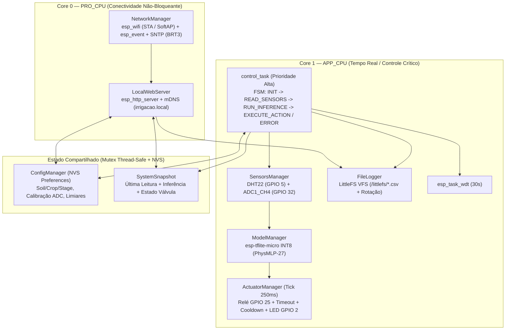
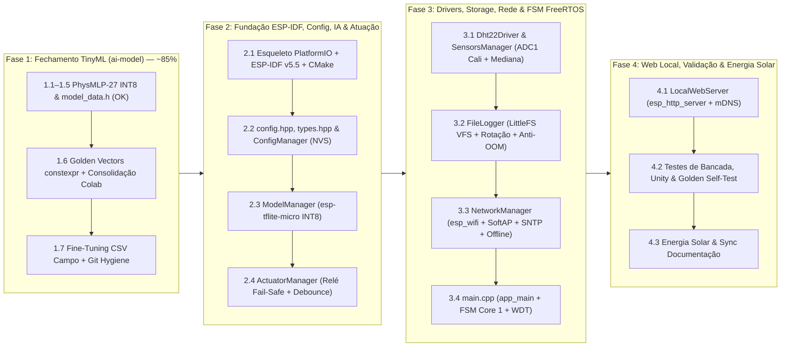

# Plano de Ação e Implementação: Modelo TinyML & Firmware ESP32 (PlatformIO + ESP-IDF)

> **Escopo deste Documento:** Diagnóstico técnico atualizado do repositório e plano estruturado de implementação para o **Modelo de IA Embarcada (`ai-model/`)** e o **Firmware ESP32 (`embedded/`)**, ignorando o diretório `web/`.
>
> **Decisão Estratégica de Firmware (Recomeço Limpo):** A pasta `embedded/` foi esvaziada intencionalmente para **recomeçar a implementação do zero**, mantendo o **PlatformIO** como gerenciador de build/upload, mas migrando integralmente de `framework = arduino` para **`framework = espidf` (ESP-IDF v5.5+ em C++17 com FreeRTOS nativo)**.
>
> **Sincronização com o Repositório:** Alinhado com `ai-model/train_tinyml_v2.py`, `ai-model/train_tinyml_v2_colab.ipynb`, `ai-model/output/train_tinyml_v2_report.json`, `docs/AUDITORIA_TINYML_E_COMPARATIVO.md` e `embedded/include/model_data.h` (C++17 puro, 100% independente de Arduino).

---

## Resumo Executivo de Progresso

| Frente / Fase | Status Atual | Resumo Objetivo |
| :--- | :---: | :--- |
| **Fase 1 — Pipeline TinyML (`ai-model/`)** | **~85% Concluída** | Modelo `PhysMLP-27` Full INT8 (`5.480 B`) treinado, auditado em 8 modos + `GroupSplit` e exportado para `embedded/include/model_data.h`. Faltam apenas ajustes finais (*Golden Vectors* em `constexpr`, modo *fine-tuning* CSV de campo, limpeza de duplicidades e commit). |
| **Fase 2 — Base ESP-IDF, Config NVS, IA & Atuação (`embedded/`)** | **0% (Recomeço do Zero)** | Apenas `platformio.ini` (ainda em Arduino), `partitions.csv`, `scripts/gzip_data.py`, `view/index.html` e `include/model_data.h` permanecem. Todo o firmware será construído do zero sobre **ESP-IDF v5.5 + CMake + IDF Component Manager**. |
| **Fase 3 — Sensores Nativos, LittleFS, Rede/SNTP & FSM FreeRTOS (`embedded/`)** | **0% (Recomeço do Zero)** | Implementação limpa desde o início já eliminando os bugs da versão anterior: ADC1 Oneshot + calibração eFuse, DHT22 determinístico, LittleFS com rotação e leitura sem OOM, Wi-Fi/SNTP 100% assíncrono/offline, FSM em task dedicada no Core 1 e Task Watchdog. |
| **Fase 4 — WebServer Local (`esp_http_server`), Testes & Energia Solar** | **0% (Recomeço do Zero)** | Servidor HTTP nativo + mDNS servindo `index.html.gz` e API local de configuração/calibração/logs, bateria de 8 testes de bancada (*Golden Self-Test* + Unity), perfil de energia solar e atualização de `docs/TODO.md` / `README.md`. |

---

## 1. Diagnóstico do Estado Atual do Repositório

### 1.1. Estado Atual e Lacunas no Modelo de IA (`ai-model/`)

#### Entregas já concluídas e verificadas
* **Artefatos presentes:**
  - `ai-model/train_tinyml_v2.py` — Pipeline oficial v2 reproduzível (`SEED = 42`).
  - `ai-model/train_tinyml_v2_colab.ipynb` — Notebook Colab v2 alinhado à auditoria (coexiste com o legado `ai-model/train_tinyml_colab.ipynb`).
  - `ai-model/benchmark_architectures.py` e `ai-model/generate_plots.py` — Benchmark experimental de 10 arquiteturas e geração de `fig01..fig12.png` + `train_tinyml_v2_diagnostics.png` em `ai-model/output/figures/`.
  - `docs/AUDITORIA_TINYML_E_COMPARATIVO.md` — Relatório forense com os 9 bugs corrigidos na v1 e fundamentação da escolha da arquitetura `PhysMLP-27`.
  - `ai-model/output/model_int8.tflite` (`5.480 B`), `ai-model/output/model_float32.tflite` (`8.216 B`), `ai-model/output/train_tinyml_v2_report.json` e `ai-model/output/benchmark_summary.json`.
  - `embedded/include/model_data.h` (sincronizado com `ai-model/model_data.h` e `ai-model/output/model_data.h`): cabeçalho **C++17 puro** (`<cstdint>`, `<cmath>`, `<algorithm>` — **pronto para ESP-IDF sem nenhuma adaptação**), contendo `g_model_data[]`, `g_model_len`, constantes, enums C++ (`SoilType`, `CropType`, `SeedlingStage`), parâmetros de quantização INT8 e funções inline (`isValidSensorReading`, `computeVpdKpa`, `encodeFeatures27`, `quantizeInput`, `dequantizeOutput`).

* **Especificação técnica verificada do modelo atual (`PhysMLP-27` v2 Full INT8):**
  - **Dataset:** `ai-model/datasets/Smart Agriculture Dataset/cropdata_updated.csv` (`16.411` $\rightarrow$ **`16.283` registros únicos** após deduplicação de `128` duplicatas exatas; `2.886` tuplas físicas únicas `(MOI, temp, humidity)`).
  - **Entradas (`27` features quantizadas em `int8`):**
    - `[0..2]`: `temp` (`[0..50 °C]`), `humidity` (`[0..100 %]`), `soilMoisture` (`[0..100 %]`) normalizados em `[0, 1]`.
    - `[3..9]`: *One-Hot* `soil_type` (`7` tipos; `0 = UNKNOWN` $\rightarrow$ vetor zero).
    - `[10..14]`: *One-Hot* `crop ID` (`5` culturas; `0 = UNKNOWN` $\rightarrow$ fallback hortaliças locais).
    - `[15..22]`: *One-Hot* `Seedling Stage` (`8` estágios; `0 = UNKNOWN` $\rightarrow$ vetor zero).
    - `[23..26]`: **4 features psicrométricas/hidrotérmicas** (`VPD_norm` via equação de Tetens, `EvapDemand`, `Temp/MOI ratio`, `MOI * Temp` coupling).
  - **Arquitetura e Treino:** `Input(27) -> Dense(32, ReLU) -> Dense(16, ReLU) -> Dense(3, Softmax)`, *Full-8 Mask Context Dropout*, validação limpa (`is_training=False`), `EarlyStopping` + `ReduceLROnPlateau` e pesos calibrados `{0: 1.0, 1: 1.15, 2: 2.20}`.
  - **Grafo TFLite verificado (`model_int8.tflite`):**
    - Tamanho: **`5.480 bytes`** (`5,35 KB`, redução de `33,3%` frente aos `8.216 B` Float32).
    - Tensores: `11` tensores; Entrada `[1, 27]` (`int8`, `scale = 3.92156886e-03`, `zero_point = -128`); Saída `[1, 3]` (`int8`, `scale = 3.90625000e-03`, `zero_point = -128`).
    - Operadores reais do grafo: **3x `FULLY_CONNECTED`** (com ReLU fundido) + **1x `SOFTMAX`**.
    - Fidelidade Keras Float32 vs TFLite INT8: concordância **`98,50%`**, `mean_abs_diff = 0,0066`, `max_abs_diff = 0,2135` (na fronteira Softmax).
  - **Métricas reais (`train_tinyml_v2_report.json`):**

| Cenário de Avaliação | Split Estratificado (70/15/15) | GroupSplit Estrito (0% *Sensor-Tuple Leakage*) |
| :--- | :---: | :---: |
| **M1: Completo `[S, C, St]`** | Acc `98,20%` \| Macro-F1 `95,29%` \| ECE `0,0054` | Acc `97,43%` \| Macro-F1 `93,99%` \| ECE `0,0026` |
| **M4: Cultura+Estágio `[0, C, St]`** | Acc `97,26%` \| Macro-F1 `93,01%` \| ECE `0,0064` | — |
| **M5: Apenas Solo `[S, 0, 0]`** | Acc `90,34%` \| Macro-F1 `78,14%` \| ECE `0,0144` | — |
| **M6: Apenas Cultura `[0, C, 0]`** | Acc `89,28%` \| Macro-F1 `76,85%` \| ECE `0,0128` | Acc `87,30%` \| Macro-F1 `74,85%` \| ECE `0,0125` |
| **M8: Zero Contexto `[0, 0, 0]`** | Acc `90,54%` \| Macro-F1 `76,84%` \| ECE `0,0171` | Acc `86,56%` \| Macro-F1 `74,88%` \| ECE `0,0323` |

#### Lacunas remanescentes em `ai-model/`
1. **Empate INT8 no Golden Vector Caso 3 (`[Atenção Crítica]`):** Em `embedded/include/model_data.h` (linha 16), o Caso 3 (*Sem Contexto — `38 °C`, `40% RH`, `75% Solo`*) produziu empate **`P0 = 0,434` vs `P2 = 0,434`** (`argmax` retornou `Class = 0`). O pós-processamento físico no `ModelManager` deve promover `OFF` (e também bloquear `IRRIGATE`) para `THERMAL_STRESS_WET_SOIL` quando `temp >= 32 °C`, `soil >= 65%` e `P(2) >= 0,40`.
2. **Golden Test Vectors apenas em comentários (`[Pendente]`):** Exportar também como `constexpr` struct array em `model_data.h` para permitir *self-test* automatizado no ESP32.
3. **Pipeline de *Fine-Tuning* com CSV de Campo (`[Pendente]`):** `train_tinyml_v2.py` ainda não aceita ingestão dos logs `/littlefs/readings.csv` e `/littlefs/inference.csv` coletados em Paulista-PE.
4. **Duplicidades e Versionamento Git (`[Organização]`):** Coexistem `train_tinyml_colab.ipynb` (legado) e `train_tinyml_v2_colab.ipynb`, além do relatório de auditoria duplicado em `ai-model/` e `docs/`; os artefatos v2 ainda estão sem commit.

---

### 1.2. Estado Atual do Firmware (`embedded/`) e Premissas da Migração para ESP-IDF

#### O que permanece na pasta `embedded/` hoje
* `embedded/platformio.ini` — Ainda configurado com `framework = arduino` e `lib_deps` de bibliotecas Arduino (`adafruit/DHT sensor library`, `tzapu/WiFiManager`). **Será reescrito para `framework = espidf`.**
* `embedded/partitions.csv` — Tabela de partições de 4 MB (`nvs 20 KB`, `otadata 8 KB`, `phy_init 4 KB`, `app0 1.69 MiB`, `app1 1.69 MiB`, `spiffs 512 KB`). **Aproveitável diretamente no ESP-IDF.**
* `embedded/include/model_data.h` — Modelo `PhysMLP-27` Full INT8 + helpers C++17 puros. **Aproveitável diretamente sem alterações.**
* `embedded/scripts/gzip_data.py` e `embedded/view/index.html` — Hook de compressão `.gz` para LittleFS (`pre:buildfs`). **Aproveitáveis para a interface local servida pelo `esp_http_server`.**
* `embedded/src/main.cpp` — Esqueleto vazio (`int main () {}`), pronto para receber `extern "C" void app_main(void)`.

#### Ambiente local PlatformIO verificado
* **PlatformIO CLI:** instalado (`~/.platformio/penv/bin/pio`).
* **Plataforma & Framework já instalados:** `espressif32 @ 55.3.39` (`pioarduino/platform-espressif32`), **`framework-espidf @ 3.50504.0` (ESP-IDF v5.5.4)**, `toolchain-xtensa-esp-elf @ 14.2.0` (GCC 14.2), `tool-cmake @ 4.0.3`, `tool-ninja @ 1.13.1`.

#### Benefícios arquiteturais da migração para ESP-IDF v5.5 (C++17)
| Aspecto | Abordagem Anterior (Arduino) | Nova Arquitetura (PlatformIO + ESP-IDF v5.5) |
| :--- | :--- | :--- |
| **Runtime TinyML** | Bibliotecas de terceiros com conflitos de C++17/`flatbuffers` | **`espressif/esp-tflite-micro`** oficial (IDF Component Manager) com kernels **ESP-NN** otimizados para Xtensa LX6 |
| **Concorrência / Tempo Real** | `loop()` monolítico bloqueado por Wi-Fi (`delay(100)` x 15s) | **FreeRTOS Dual-Core**: Rede/HTTP no **Core 0** e Controle/IA/Atuação em task dedicada de alta prioridade no **Core 1** |
| **Tempo Monotônico** | `millis()` (`uint32_t`, overflow em 49,7 dias) | `esp_timer_get_time()` (`int64_t` em µs, sem overflow prático) |
| **Leitura ADC (HW-080)** | `analogRead()` cru sem atenuação nem calibração | **`esp_adc/adc_oneshot.h` + `esp_adc/adc_cali.h`** (`ADC_UNIT_1`, `ADC_CHANNEL_4` / GPIO 32, `ADC_ATTEN_DB_12`, calibração eFuse) |
| **Persistência Config** | Inexistente (hardcoded) | **`nvs_flash` / `nvs.h`** nativo na partição `nvs` (`20 KB`) com versionamento de schema |
| **Armazenamento CSV** | `LittleFS` Arduino sem rotação e `readAll` com risco de OOM | **`joltwallet/littlefs`** via VFS POSIX (`fopen`/`fgets`), rotação automática de tamanho e leitura reversa sem OOM |
| **Wi-Fi, NTP & Web Local** | `WiFiManager` bloqueante + NTP ausente + WebServer inativo | **`esp_wifi` + `esp_event`** assíncrono + fallback SoftAP próprio + **`esp_sntp`** (`BRT3`) + **`esp_http_server`** + **`espressif/mdns`** |
| **Logs & Segurança** | `Serial.printf` + sem Watchdog + relé sem polaridade | **`esp_log.h`** (`ESP_LOGI/W/E`) + **`esp_task_wdt`** (30s) + relé configurável (`RELAY_ACTIVE_LOW`) sem glitch no boot |

---

## 2. Arquitetura-Alvo do Firmware (`embedded/` — ESP-IDF v5.5 + C++17)

### 2.1. Estrutura de Diretórios (Limpa, do Zero)

```text
embedded/
├── CMakeLists.txt                  # Projeto raiz CMake (ESP-IDF)
├── platformio.ini                  # PlatformIO com framework = espidf
├── partitions.csv                  # 4 MB Flash: nvs, otadata, phy_init, app0, app1, spiffs (LittleFS 512 KB)
├── sdkconfig.defaults              # Configurações determinísticas (C++17, WDT, Partition Table, WiFi, LittleFS)
├── scripts/
│   └── gzip_data.py                # Compressão automática view/ -> data/*.gz no buildfs/uploadfs
├── view/
│   └── index.html                  # Interface web embarcada (status, contexto agronômico, calibração, CSVs)
├── data/                           # Gerado automaticamente pelo gzip_data.py
├── include/
│   ├── config.hpp                  # Pinagem, polaridade relé, constantes de rede, NTP e segurança
│   ├── types.hpp                   # Contratos compartilhados (SensorData, SystemConfig, InferenceResult, SystemState)
│   └── model_data.h                # Modelo TinyML v2 (PhysMLP-27 INT8) — já presente
└── src/
    ├── CMakeLists.txt              # Componente principal IDF (SRCS, INCLUDE_DIRS, REQUIRES)
    ├── idf_component.yml           # espressif/esp-tflite-micro, joltwallet/littlefs, espressif/mdns
    ├── main.cpp                    # extern "C" void app_main(void) — Bootstrap, FreeRTOS Tasks e FSM
    ├── core/
    │   ├── ConfigManager.hpp/.cpp  # Persistência NVS (nvs_open / nvs_get_blob / validação + defaults)
    │   └── TimeUtils.hpp/.cpp      # Timestamp ISO-8601 thread-safe (localtime_r) + fallback uptime offline
    ├── drivers/
    │   ├── Dht22Driver.hpp/.cpp    # Driver nativo ESP-IDF DHT22 (GPIO 5, seção crítica portMUX / validação checksum)
    │   └── SensorsManager.hpp/.cpp # DHT22 + ADC1 Oneshot/Cali (GPIO 32) + filtro mediana 10x + detecção de falha
    ├── ai/
    │   └── ModelManager.hpp/.cpp   # esp-tflite-micro INT8 (PhysMLP-27) + fallback térmico + Golden Self-Test
    ├── control/
    │   └── ActuatorManager.hpp/.cpp# Relé (GPIO 25), LED (GPIO 2), timeout, cooldown, debounce e emergencyStop()
    ├── storage/
    │   └── FileLogger.hpp/.cpp     # VFS LittleFS (/littlefs), readings.csv, inference.csv, rotação e leitura anti-OOM
    └── net/
        ├── NetworkManager.hpp/.cpp # esp_wifi STA + SoftAP provisionamento assíncrono + SNTP (UTC-3) + modo offline
        └── LocalWebServer.hpp/.cpp # esp_http_server + mdns (irrigacao.local), API JSON e download CSV por streaming
```

### 2.2. Arquitetura de Concorrência (FreeRTOS Dual-Core)



---

## 3. Plano de Ação e Implementação (Passo a Passo)



---

### FASE 1: Fechamento do Pipeline de IA (`ai-model/`)

> **Decisões de Arquitetura Consolidadas:**
> 1. **Modelo Oficial:** `PhysMLP-27` (`27 -> 32 ReLU -> 16 ReLU -> 3 Softmax`), Full INT8 (`5.480 B`), operadores `FULLY_CONNECTED` + `SOFTMAX`.
> 2. **3 Estados de Saída (`Softmax`):** `0 = OFF`, `1 = IRRIGATE`, `2 = THERMAL_STRESS_WET_SOIL` (válvula mantida fechada + alerta de estresse térmico).
> 3. **Contexto Opcional (*Full-8 Mask Context Dropout*):** `0 = UNKNOWN` (vetor zero no One-Hot, fallback para hortaliças locais) sem jamais bloquear a inferência.
> 4. **Pesos Calibrados `{0: 1.0, 1: 1.15, 2: 2.20}` e Proteção de Sentinelas:** Rejeição explícita de `-128`, `-999`, `255` e `NaN` antes do `clamp`.

#### Etapas 1.1 a 1.5 — `[CONCLUÍDAS em ai-model/train_tinyml_v2.py]`
* Deduplicação (`16.411` $\rightarrow$ `16.283`), Split estratificado `70/15/15` + `GroupSplit` (0% *leakage*), engenharia psicrométrica (`27` features), treino `PhysMLP-27`, quantização Full INT8 (`5.480 B`), validação no `tf.lite.Interpreter` e exportação automática para `embedded/include/model_data.h`.

#### Etapa 1.6 — *Golden Vectors* Compiláveis e Consolidação dos Notebooks `[Pendente]`
* **Objetivo:** Permitir *self-test* automatizado no ESP32 e eliminar duplicidade entre notebooks.
* **Ações:**
  1. Em `train_tinyml_v2.py` (`generate_cpp_header()`) e `train_tinyml_v2_colab.ipynb`, exportar os 6 casos de teste como array `constexpr` em `namespace TinyMLConfig` (`struct GoldenVector { float temp, hum, soil; uint8_t soilId, cropId, stageId, expectedRawClass; float expectedProbs[3]; };` + `constexpr GoldenVector GOLDEN_VECTORS[6]`), documentando que o Caso 3 testa explicitamente a promoção pelo fallback físico do `ModelManager`.
  2. Descontinuar o notebook legado `train_tinyml_colab.ipynb`, mantendo `train_tinyml_v2.py` e `train_tinyml_v2_colab.ipynb` como fontes canônicas.

#### Etapa 1.7 — *Fine-Tuning* com Dados de Campo e Higiene Git `[Pendente]`
* **Objetivo:** Fechar o ciclo de re-treinamento com os logs coletados em Paulista-PE e organizar o versionamento.
* **Ações:**
  1. Adicionar modo opcional em `train_tinyml_v2.py` (`--field-readings`, `--field-inferences`, `--epochs-ft`, `--lr-ft`) para ingerir CSVs do LittleFS, filtrar sentinelas e executar *fine-tuning* incremental.
  2. Consolidar o relatório de auditoria em `docs/AUDITORIA_TINYML_E_COMPARATIVO.md` e versionar os artefatos v2 no Git.

---

### FASE 2: Fundação PlatformIO + ESP-IDF, Configuração NVS, TinyML e Atuação (`embedded/`)

#### Etapa 2.1 — Migração do Projeto PlatformIO para ESP-IDF v5.5 (`platformio.ini`, `CMakeLists.txt`, `sdkconfig.defaults`) `[Pendente]`
* **Objetivo:** Estabelecer uma base ESP-IDF v5.5 compilável do zero no PlatformIO com C++17 e IDF Component Manager.
* **Ações:**
  1. Reescrever `embedded/platformio.ini` para `framework = espidf`:
     ```ini
     [env:esp32doit-devkit-v1]
     platform = espressif32
     board = esp32doit-devkit-v1
     framework = espidf
     monitor_speed = 115200
     monitor_filters = esp32_exception_decoder, colorize
     board_build.partitions = partitions.csv
     board_build.filesystem = littlefs
     extra_scripts = pre:scripts/gzip_data.py
     ```
     *(Obs.: se necessário fixar a plataforma já instalada `pioarduino` com IDF v5.5.4, validar `pio run` logo nesta etapa antes de avançar).*
  2. Criar `embedded/CMakeLists.txt` (raiz do projeto IDF) e `embedded/src/CMakeLists.txt` registrando os diretórios de código e `INCLUDE_DIRS "../include" "."`, com `target_compile_options(${COMPONENT_LIB} PRIVATE $<$<COMPILE_LANGUAGE:CXX>:-std=gnu++17>)`.
  3. Criar `embedded/src/idf_component.yml` declarando as dependências oficiais:
     ```yaml
     dependencies:
       idf: ">=5.1"
       espressif/esp-tflite-micro: "^1.3.0"
       joltwallet/littlefs: "^1.14.0"
       espressif/mdns: "^1.4.0"
     ```
  4. Criar `embedded/sdkconfig.defaults` configurando:
     - Tabela de partições customizada (`CONFIG_PARTITION_TABLE_CUSTOM=y`, `CONFIG_PARTITION_TABLE_CUSTOM_FILENAME="partitions.csv"`).
     - `CONFIG_ESP_TASK_WDT_EN=y`, `CONFIG_ESP_TASK_WDT_TIMEOUT_S=30`, `CONFIG_ESP_TASK_WDT_PANIC=y`.
     - Stack da task principal adequada (`CONFIG_ESP_MAIN_TASK_STACK_SIZE=8192`).
     - Otimização de compilação (`CONFIG_COMPILER_OPTIMIZATION_SIZE=y` ou `PERF=y` para ESP-NN) e `CONFIG_COMPILER_CXX_EXCEPTIONS=n` / `CONFIG_COMPILER_CXX_RTTI=n` (menor Flash e determinismo embarcado).
     - `CONFIG_HTTPD_MAX_REQ_HDR_LEN=1024` e suporte a `CONFIG_LWIP_SO_REUSE=y`.
  5. Validar o primeiro build mínimo (`extern "C" void app_main(void)` logando via `ESP_LOGI`) com `pio run`.

#### Etapa 2.2 — Constantes, Contratos Compartilhados e `ConfigManager` sobre NVS (`config.hpp`, `types.hpp`, `ConfigManager`) `[Pendente]`
* **Objetivo:** Definir pinagem, tipos de dados sem acoplamento e persistência segura em NVS (`20 KB`).
* **Ações:**
  1. Criar `embedded/include/config.hpp` (`namespace Config`):
     - **Pinagem:** `DHT_SENSOR_PIN = GPIO_NUM_5`, `SOIL_MOISTURE_ADC_PIN = GPIO_NUM_32` (`ADC_UNIT_1`, `ADC_CHANNEL_4`), `RELAY_VALVE_PIN = GPIO_NUM_25`, `STATUS_LED_PIN = GPIO_NUM_2`.
     - **Hardware:** `constexpr bool RELAY_ACTIVE_LOW = true;` (configurável conforme o relé físico da bancada), `constexpr uint8_t CONSECUTIVE_IRRIGATE_CONFIRMATIONS = 2;`.
     - **Rede & NTP:** `DEFAULT_AP_SSID = "ESP-Irrigacao"`, `DEFAULT_MDNS_HOST = "irrigacao"`, `NTP_SERVER_PRIMARY = "a.st1.ntp.br"`, `NTP_SERVER_SECONDARY = "pool.ntp.org"`, `TIMEZONE_POSIX = "BRT3"` (UTC-3 fixo, Paulista-PE).
     - **LittleFS:** `LITTLEFS_MOUNT_POINT = "/littlefs"`, `LITTLEFS_PARTITION_LABEL = "spiffs"` (garante compatibilidade 100% com `pio run -t uploadfs` e `partitions.csv`), `MAX_READINGS_LOG_BYTES = 180 * 1024`, `MAX_INFERENCE_LOG_BYTES = 180 * 1024`.
  2. Criar `embedded/include/types.hpp` contendo `SystemState`, `SensorData`, `AgronomicContext`, `IrrigationDecision`, `InferenceResult`, `SystemConfig` e `SystemSnapshot`.
  3. Implementar `ConfigManager` (`nvs_flash_init()` com auto-recuperação em `ESP_ERR_NVS_NO_FREE_PAGES` / `ESP_ERR_NVS_NEW_VERSION_FOUND`, namespace `"irrig_cfg"`, `CONFIG_SCHEMA_VERSION`, `load()`, `save()`, `resetDefaults()` e validação de faixas para todos os parâmetros: `soilType`, `cropId`, `seedlingStage`, `confidenceThreshold`, `thermalStressThreshold`, `soilAdcDry`, `soilAdcWet`, `maxIrrigationMs`, `cooldownMs`, `sensorReadIntervalMs`, `logIntervalMs`).

#### Etapa 2.3 — Criação do `ModelManager` com `espressif/esp-tflite-micro` (Full INT8) `[Pendente]`
* **Objetivo:** Executar a inferência `PhysMLP-27` Full INT8 no ESP32 com máxima fidelidade, proteção contra sentinelas e fallback físico de estresse térmico.
* **Ações:**
  1. Implementar `ModelManager::init()` (`esp_err_t`):
     - Carregar `tflite::GetModel(g_model_data)` e validar `TFLITE_SCHEMA_VERSION`.
     - Declarar `tflite::MicroMutableOpResolver<3>` registrando **`AddFullyConnected()`**, **`AddSoftmax()`** (operadores verificados de `model_int8.tflite`) e `AddRelu()` (defensivo).
     - Alocar `alignas(16) uint8_t m_tensorArena[8 * 1024];` (expansível para `10–12 KB` se necessário) e registrar `ESP_LOGI(TAG, "Arena usada: %zu bytes", m_interpreter->arena_used_bytes())`.
     - Validar `input->type == kTfLiteInt8`, `input->dims->data[1] == 27`, `output->type == kTfLiteInt8`, `output->dims->data[1] == 3`.
  2. Implementar `ModelManager::predict(const SensorData &data, const AgronomicContext &ctx)`:
     - **Fail-Safe de Hardware:** Se `!data.valid` ou `!TinyMLConfig::isValidSensorReading(tempC, humPct, soilPct)`, retornar imediatamente `valid = false`, `decision = OFF`, `shouldIrrigate = false`.
     - **Pré-processamento 27D:** Chamar `TinyMLConfig::encodeFeatures27(...)` já disponível em `embedded/include/model_data.h`.
     - **Quantização INT8:** Quantizar os 27 floats para `input->data.int8[i]` usando `input->params.scale` e `input->params.zero_point`.
     - **Inferência:** Medir latência via `esp_timer_get_time()` (`latencyUs`) e chamar `m_interpreter->Invoke()`.
     - **Desquantização e Pós-processamento Físico:** Desquantizar `output->data.int8[0..2]`, calcular `argmax` e `confidence`. Aplicar a regra física complementar:
       - Se `tempC >= TinyMLConfig::THERMAL_STRESS_TEMP_MIN_C` (`32 °C`) **e** `soilPct >= TinyMLConfig::THERMAL_STRESS_SOIL_CAP_PCT` (`65%`):
         - Caso `decision == IRRIGATE` **ou** `probabilities[2] >= ctx.thermalStressThreshold` (`0,40` — resolvendo o empate `P0=0.434 / P2=0.434` do Caso 3 em Zero Contexto), classificar como `THERMAL_STRESS_WET_SOIL`, `shouldIrrigate = false`, `thermalStressAlert = true`, `fallbackTriggered = true`.
     - Definir `shouldIrrigate = (decision == IrrigationDecision::IRRIGATE && confidence >= ctx.confidenceThreshold)`.
  3. Implementar `bool runGoldenSelfTest()` verificando os 6 *Golden Test Vectors* contra o interpretador C++ INT8 no boot (em modo diagnóstico ou via teste Unity).

#### Etapa 2.4 — Criação do `ActuatorManager` (Relé *Fail-Safe*, Debounce e LED) `[Pendente]`
* **Objetivo:** Controlar a válvula solenoide/bomba e o LED de status via `driver/gpio.h` com proteções determinísticas baseadas em `esp_timer_get_time()`.
* **Ações:**
  1. Em `ActuatorManager::init()`:
     - Escrever o nível elétrico de repouso (`RELAY_ACTIVE_LOW ? 1 : 0`) no GPIO 25 **antes** de ativar `GPIO_MODE_OUTPUT` (evita acionamento momentâneo no boot/reset!).
     - Configurar `STATUS_LED_PIN` (GPIO 2) como saída.
  2. Implementar lógica de segurança não-bloqueante (`update()` chamado a cada `250 ms` na task do Core 1):
     - **Timeout máximo contínuo (`maxIrrigationMs`):** Fecha válvula imediatamente ao exceder o tempo limite e entra em *cooldown*.
     - **Cooldown obrigatório (`cooldownMs`):** Impede reabertura imediata após fechar, aguardando percolação da água no solo.
     - **Debounce anti-*chattering*:** Exige `CONSECUTIVE_IRRIGATE_CONFIRMATIONS` ciclos consecutivos de `shouldIrrigate == true` para abrir; o fechamento (`OFF`, `THERMAL_STRESS_WET_SOIL`, `ERROR`) é **instantâneo**.
     - **`emergencyStop()`:** Fecha a válvula imediatamente, limpa contadores e ativa padrão de alerta de erro no LED.
  3. Implementar padrões de pisca não-bloqueantes no `STATUS_LED` por estado (`OFF`, `IRRIGATING`, `THERMAL_STRESS`, `ERROR`).

---

### FASE 3: Drivers Nativos, Armazenamento LittleFS, Rede Assíncrona e FSM FreeRTOS (`embedded/`)

#### Etapa 3.1 — Drivers Nativos: `Dht22Driver` e `SensorsManager` (`ADC1 Oneshot + Calibração eFuse`) `[Pendente]`
* **Objetivo:** Obter leituras precisas, filtradas e blindadas contra desconexão física sem depender de bibliotecas Arduino.
* **Ações:**
  1. **`Dht22Driver` (GPIO 5):**
     - Implementar leitura do protocolo 1-wire do DHT22 com `driver/gpio.h`, `esp_rom_delay_us()` e seção crítica (`portMUX_TYPE` / `portENTER_CRITICAL`) apenas durante a janela de captura dos 40 bits (~`4 ms`), validando o byte de *checksum* e aplicando até `2` retentativas respeitando intervalo mínimo de `2.000 ms` entre leituras.
     - Retornar `esp_err_t` (`ESP_OK`, `ESP_ERR_TIMEOUT`, `ESP_ERR_INVALID_CRC`).
  2. **`SensorsManager`:**
     - **Temperatura em Ponto Fixo (`int16_t` x10):** Armazenar `static_cast<int16_t>(std::lround(tempC * 10.0f))` com sentinela de erro **`-999`** (expondo helper `getTemperatureC()`). Umidade do ar em `uint8_t` (`0..100`, sentinela **`255`**).
     - **Sensor de Solo HW-080 (GPIO 32 = `ADC_UNIT_1`, `ADC_CHANNEL_4`):**
       - Inicializar com `adc_oneshot_new_unit`, `adc_oneshot_config_channel` (`ADC_BITWIDTH_12`, `ADC_ATTEN_DB_12`) e calibração via `adc_cali_create_scheme_line_fitting`.
       - Coletar **`10` amostras** espaçadas por `2 ms`, ordenar e extrair a **mediana** (imune a picos de RF/Wi-Fi).
       - Mapear com `soilAdcDry` / `soilAdcWet` do `ConfigManager` (com `std::clamp(0, 100)`).
       - Detectar falha elétrica (fio solto `raw >= 4090` ou curto `raw <= 10`) retornando sentinela **`255`** e marcando `data.valid = false`.
     - Preencher timestamp via `TimeUtils::getFormattedTimestamp()` e definir `data.valid = true` somente se todas as grandezas estiverem válidas.

#### Etapa 3.2 — `FileLogger` sobre LittleFS VFS (`joltwallet/littlefs` + Rotação + Anti-OOM) `[Pendente]`
* **Objetivo:** Persistir histórico de sensores e inferências em CSV compatível com o pipeline Python de *fine-tuning* sem jamais lotar os `512 KB` nem causar OOM na RAM.
* **Ações:**
  1. Montar o sistema de arquivos via `esp_vfs_littlefs_register` com `base_path = "/littlefs"`, `partition_label = "spiffs"`, `format_if_mount_failed = true`.
  2. Garantir criação dos arquivos com cabeçalhos padronizados:
     - `/littlefs/readings.csv`: `temperatura_c,umidade,umidade_solo,adc_bruto,valido,timestamp` (temperatura formatada com 1 casa decimal, ex: `25.4`).
     - `/littlefs/inference.csv`: `temperatura_c,umidade,umidade_solo,soil_id,crop_id,stage_id,p_off,p_irrigate,p_stress,decisao,valvula_aberta,fallback,timestamp`.
  3. Proteger operações de disco com `SemaphoreHandle_t` (mutex), pois `control_task` (Core 1) escreve enquanto `LocalWebServer` (Core 0) pode fazer download por *streaming*.
  4. **Rotação automática de logs:** Antes de anexar linha, verificar `stat()` do arquivo. Ao atingir `180 KB`, rotacionar (`rename("/littlefs/readings.csv", "/littlefs/readings.prev.csv")` ou truncamento seguro mantendo espaço livre garantido no `512 KB` do LittleFS).
  5. **Leitura recente sem OOM:** Implementar `readRecentReadings(size_t n)` e `readRecentInferences(size_t n)` usando *ring buffer* de tamanho fixo `n` (ou leitura a partir do fim com `fseek`), jamais carregando o arquivo inteiro na heap.

#### Etapa 3.3 — `NetworkManager` (Wi-Fi Assíncrono, Provisionamento SoftAP, SNTP e Modo Offline) `[Pendente]`
* **Objetivo:** Garantir conectividade robusta sem jamais bloquear o controle da válvula, com relógio sincronizado via SNTP e autonomia total em lavoura sem internet.
* **Ações:**
  1. Inicializar `esp_netif_init()`, `esp_event_loop_create_default()`, `esp_netif_create_default_wifi_sta()`, `esp_netif_create_default_wifi_ap()` e `esp_wifi_init()`.
  2. Gerenciar eventos de forma 100% assíncrona via `esp_event_handler_instance_register`:
     - **`WIFI_EVENT_STA_START`:** Se houver SSID salvo na NVS, chamar `esp_wifi_connect()`; caso contrário, ativar **SoftAP de provisionamento** (`SSID = "ESP-Irrigacao"`, sub-rede coerente `192.168.4.1/24`) para o usuário configurar a rede Wi-Fi pela interface web local.
     - **`WIFI_EVENT_STA_DISCONNECTED`:** Agendar reconexão via `esp_timer` com *backoff* exponencial (`10s -> 30s -> 60s -> 300s`), **sem nenhum `vTaskDelay` ou loop bloqueante**, e **sem apagar credenciais da NVS**. Após `N` falhas no boot sem rede, habilitar temporariamente o SoftAP em modo `WIFI_MODE_APSTA` por `240s` e desligar o AP após timeout para economizar energia.
     - **`IP_EVENT_STA_GOT_IP`:** Salvar IP/RSSI em cache, iniciar mDNS e disparar **SNTP uma única vez** (`setenv("TZ", "BRT3", 1); tzset(); esp_sntp_setoperatingmode(ESP_SNTP_OPMODE_POLL); esp_sntp_setservername(0, "a.st1.ntp.br"); esp_sntp_setservername(1, "pool.ntp.org"); esp_sntp_init();`).
  3. **Operação 100% offline:** Se não houver roteador/internet, o sistema continua lendo sensores, rodando a IA e acionando a válvula normalmente; `TimeUtils` detecta `tm_year < 120` e gera fallback explícito (`UPTIME_000123s` ou `0000-00-00 00:00:00`) até a sincronização SNTP ocorrer.

#### Etapa 3.4 — Integração da Máquina de Estados FreeRTOS e Watchdog em `src/main.cpp` `[Pendente]`
* **Objetivo:** Orquestrar o bootstrap em `extern "C" void app_main(void)` e executar o loop determinístico da FSM no Core 1.
* **Ações:**
  1. Em `app_main()`:
     - Inicializar `ConfigManager` (NVS), `FileLogger` (LittleFS), `ActuatorManager` (válvula garantidamente fechada), `SensorsManager`, `ModelManager` (TFLM INT8 + *Golden Self-Test* opcional), `NetworkManager` e `LocalWebServer`.
     - Criar `control_task` fixada no **Core 1 (`xTaskCreatePinnedToCore(..., 1)`)** com stack de `8192 bytes` (espaço seguro para TFLM + logging) e prioridade `5`, registrando-a no **Task Watchdog (`esp_task_wdt_add(NULL)`)**.
  2. Na `control_task` (ciclo base de `250 ms` com `vTaskDelay(pdMS_TO_TICKS(250))`):
     - Em todo tick (`250 ms`): chamar `esp_task_wdt_reset()` e `actuatorManager.update()` (garante desligamento exato no *timeout* e pisca suave do LED).
     - Executar `switch (currentState)`:
       - **`SystemState::INIT`:** Valida inicialização crítica (`ModelManager`, `SensorsManager`, `ActuatorManager`). Se modelo falhar $\rightarrow$ `SystemState::ERROR`; se OK $\rightarrow$ `SystemState::READ_SENSORS`.
       - **`SystemState::READ_SENSORS`:** Ao atingir `cfg.sensorReadIntervalMs`, executa `sensorsManager.readSensors()`. Se `!data.valid`, incrementa falhas consecutivas (ao atingir `3` falhas $\rightarrow$ `SystemState::ERROR`). Se válido $\rightarrow$ registra em `readings.csv` (respeitando `cfg.logIntervalMs`) e avança para `SystemState::RUN_INFERENCE`.
       - **`SystemState::RUN_INFERENCE`:** Executa `modelManager.predict(sensorData, context)`. Se `!result.valid` $\rightarrow$ `SystemState::ERROR`. Caso contrário, grava em `inference.csv` (respeitando `cfg.logIntervalMs` ou sempre que mudar decisão/alerta) e avança para `SystemState::EXECUTE_ACTION`.
       - **`SystemState::EXECUTE_ACTION`:** Aplica `actuatorManager.applyDecision(result)`, atualiza `SystemSnapshot` sob mutex, emite log estruturado (`ESP_LOGI`) e retorna para `SystemState::READ_SENSORS`.
       - **`SystemState::ERROR`:** Aciona `actuatorManager.emergencyStop()`, registra código de falha via `ESP_LOGE`, atualiza snapshot com estado de erro e agenda nova tentativa de recuperação em `READ_SENSORS` no próximo ciclo.

---

### FASE 4: Interface Web Local Embarcada, Testes de Bancada, Energia Solar e Documentação

#### Etapa 4.1 — `LocalWebServer` (`esp_http_server` + `espressif/mdns`) `[Pendente]`
* **Objetivo:** Permitir configuração em campo do canteiro, Wi-Fi, calibração do HW-080 e coleta dos logs CSV diretamente no celular (sem precisar regravar firmware nem depender da pasta `web/`).
* **Ações:**
  1. Iniciar `mdns_init()`, `mdns_hostname_set("irrigacao")` (`http://irrigacao.local`) e `httpd_start()`.
  2. Implementar rotas HTTP leves usando `cJSON`:
     - `GET /` $\rightarrow$ serve `/littlefs/index.html.gz` com header `Content-Encoding: gzip` (gerado por `scripts/gzip_data.py`).
     - `GET /api/status` $\rightarrow$ JSON com `SystemSnapshot` (temperatura °C, umidade %, solo %, ADC bruto, probabilidades `[P0, P1, P2]`, decisão, alerta térmico, estado da válvula, *cooldown* restante, latência µs, heap livre, status Wi-Fi/SNTP).
     - `GET /api/config` e `POST /api/config` $\rightarrow$ lê/atualiza `SystemConfig` no `ConfigManager` (NVS).
     - `POST /api/wifi` $\rightarrow$ salva SSID/senha via `esp_wifi_set_config` e inicia conexão STA sem travar.
     - `POST /api/calibrate/dry` e `POST /api/calibrate/wet` $\rightarrow$ lê mediana atual do ADC1 e persiste em NVS.
     - `GET /logs/readings.csv` e `GET /logs/inference.csv` $\rightarrow$ download por *chunked transfer* (`httpd_resp_send_chunk` em buffers de `1024 B`, sem alocar o arquivo inteiro na RAM).

#### Etapa 4.2 — Protocolo de Testes e Critérios de Aceitação (*Definition of Done*) `[Pendente]`
1. **Build Limpo ESP-IDF:** `pio run` e `pio run -t buildfs` concluem sem erros, com Flash `< 75%` de `app0` e SRAM estática `< 55%`.
2. **Fidelidade Numérica C++ vs Python (*Golden Self-Test*):** Os 6 *Golden Test Vectors* executados no `esp-tflite-micro` INT8 atingem `|P_esp32[c] - P_python[c]| <= 0,01` e `100%` de concordância nas decisões finais (incluindo Caso 3 promovido para `THERMAL_STRESS_WET_SOIL` pelo fallback físico).
3. **Latência de Inferência:** `latencyUs < 3.000 µs` (`< 3 ms`) no ESP32 a `240 MHz` com ESP-NN.
4. **Teste de Falha Física (*Fail-Safe*):** Desconectar DHT22 ou HW-080 com válvula aberta $\rightarrow$ detecção de sentinela (`-999`/`255`) $\rightarrow$ `SystemState::ERROR` $\rightarrow$ fechamento imediato da válvula.
5. **Teste de Segurança Hidráulica:** Solo seco contínuo (`15%`) $\rightarrow$ abertura somente após `2` confirmações consecutivas, corte exato no `maxIrrigationMs` e bloqueio de reabertura durante todo o `cooldownMs`.
6. **Teste de Estresse Térmico (Classe 2):** Cenário `38 °C`, `40% RH`, `75% Solo` $\rightarrow$ válvula mantida fechada + `thermalStressAlert = true` gravado em `inference.csv`.
7. **Teste de Queda Wi-Fi / Autonomia Offline:** Desligar roteador durante irrigação $\rightarrow$ válvula fecha no tempo exato (zero bloqueio no Core 1) e ciclo autônomo continua normalmente.
8. **Teste de Estresse LittleFS & Heap:** Validar rotação automática ao atingir teto de `180 KB` e estabilidade de `esp_get_free_heap_size()` após múltiplas chamadas a `/api/status` e `/logs/*.csv`.

#### Etapa 4.3 — Eficiência Energética (Painel Solar) `[Planejamento Pós-Bancada]`
* **Modo Conectado (WebServer ativo):** Ativar `esp_wifi_set_ps(WIFI_PS_MIN_MODEM)` (*Modem Sleep* nativo do ESP-IDF) e avaliar redução de clock para `160 MHz` via `CONFIG_ESP_DEFAULT_CPU_FREQ_MHZ_160`.
* **Modo Autônomo Rural (Máxima Economia):** Perfil opcional com `esp_deep_sleep_start()` (ciclo de `5–15 min` via timer RTC, alimentação chaveada dos sensores por MOSFET para evitar corrosão eletrolítica do HW-080, preservando estado de *cooldown* em `RTC_DATA_ATTR`).

#### Etapa 4.4 — Sincronização Documental do Repositório `[Pendente]`
* Atualizar `docs/TODO.md` (refletindo a arquitetura ESP-IDF, marcando Fase 1 de IA concluída e zerando os módulos de `embedded/` até serem reimplementados e testados).
* Atualizar `README.md` (substituindo menções a Arduino / `train_tinyml.py` / dataset sintético pela stack oficial **PlatformIO + ESP-IDF v5.5** e `train_tinyml_v2.py` / `PhysMLP-27` INT8).

---

## 4. Orçamento de Recursos no ESP32 (`esp32doit-devkit-v1`, 4 MB Flash / 520 KB SRAM)

| Recurso | Capacidade (`partitions.csv`) | Uso Estimado / Verificado (ESP-IDF v5.5) | Margem & Observações |
| :--- | :---: | :---: | :--- |
| **Flash App (`app0` / `app1` OTA)** | `1.769.472 B` (`1,69 MiB` cada) | ~`750 KB – 1,05 MB` (ESP-IDF + WiFi + HTTPD + LittleFS + `esp-tflite-micro` + modelo) | ~`200–300 KB` mais enxuto que o equivalente Arduino; folga > `650 KB` com OTA ativo. |
| **Modelo TinyML (`g_model_data`)** | Flash `.rodata` | **`5.480 B` (`5,35 KB`)** *(verificado)* | `0,31%` da partição `app0`. |
| **TFLite `tensor_arena` (SRAM)** | `520 KB` SRAM (~`220 KB` heap livre pós-WiFi) | **`8 KB – 12 KB`** (`alignas(16)`) | Grafo possui apenas `11` tensores INT8 (`27 -> 32 -> 16 -> 3`). |
| **Stacks FreeRTOS** | SRAM | `control_task`: `8 KB` \| `httpd`: `6 KB` \| `main`: `8 KB` | Margem ampla contra stack overflow (verificável via `uxTaskGetStackHighWaterMark`). |
| **Partição `nvs`** | `20 KB` (`0x5000`) | `< 2 KB` (`SystemConfig` + credenciais Wi-Fi IDF) | Protegida contra corrupção/desgaste dos logs CSV. |
| **Partição `spiffs` (LittleFS)** | `512 KB` (`0x80000`) | `index.html.gz` (~`2 KB`) + `readings.csv` (teto `180 KB`) + `inference.csv` (teto `180 KB`) | Com log a cada `60s` (`1.440` linhas/dia $\approx$ `45–80 KB/dia`), retém ~`2–4 dias` contínuos antes da rotação automática. |

---

## 5. Checklist Mestre de Execução

### Fase 1 — Pipeline TinyML (`ai-model/`)
- [x] **Passo 1.1:** Dataset real (`cropdata_updated.csv`), deduplicação (`128` linhas), normalização `[0, 1]` e engenharia psicrométrica (`PhysMLP-27`, `27` features).
- [x] **Passo 1.2:** Split estratificado `70/15/15` + `GroupSplit` (0% *leakage*), *Full-8 Mask Context Dropout* e pesos calibrados `{0: 1.0, 1: 1.15, 2: 2.20}`.
- [x] **Passo 1.3:** Quantização real Full INT8 (`5.480 B`, `98,50%` concordância) e exportação de `embedded/include/model_data.h` (C++17 puro).
- [x] **Passo 1.4:** Exportar `GOLDEN_VECTORS` como array `constexpr` em `model_data.h` e manter `train_tinyml_v2.py` sincronizado.
- [x] **Passo 1.5:** Adicionar modo *fine-tuning* (`--field-readings` / `--field-inferences`) em `train_tinyml_v2.py` (restam apenas limpeza opcional dos arquivos legados e commit no Git).

### Fase 2 — Fundação ESP-IDF, Config NVS, IA e Atuação (`embedded/`)
- [x] **Passo 2.1:** Migrar `embedded/platformio.ini` para `framework = espidf`, criar `CMakeLists.txt`, `src/CMakeLists.txt`, `src/idf_component.yml`, `sdkconfig.defaults` e validar compilação via `pio run` (`53,0%` Flash, `15,6%` RAM).
- [x] **Passo 2.2:** Criar `include/config.hpp`, `include/types.hpp` e implementar `ConfigManager` sobre NVS (`nvs_flash` / `nvs.h`).
- [x] **Passo 2.3:** Implementar `ModelManager` sobre `espressif/esp-tflite-micro` (INT8, `PhysMLP-27`, validação de sentinelas, fallback físico Classe 2 e `runGoldenSelfTest()`).
- [x] **Passo 2.4:** Implementar `ActuatorManager` (`driver/gpio.h`, `RELAY_ACTIVE_LOW`, *timeout*, *cooldown*, debounce anti-*chattering*, `emergencyStop()` e padrões no `STATUS_LED`).

### Fase 3 — Drivers Nativos, LittleFS, Rede Assíncrona e FSM (`embedded/`)
- [x] **Passo 3.1:** Implementar `Dht22Driver` (GPIO 5) e `SensorsManager` (`int16_t` x10 com sentinela `-999`, `ADC_UNIT_1`/`ADC_CHANNEL_4`/`ADC_ATTEN_DB_12` + calibração eFuse + mediana 10x + detecção de desconexão HW-080).
- [x] **Passo 3.2:** Implementar `FileLogger` (`joltwallet/littlefs` VFS `/littlefs`, `readings.csv` + `inference.csv`, mutex, rotação automática e leitura recente sem OOM) e `TimeUtils`.
- [x] **Passo 3.3:** Implementar `NetworkManager` (`esp_wifi` STA + SoftAP de provisionamento assíncrono, *backoff* via `esp_timer`, `esp_sntp` `BRT3` e operação 100% offline).
- [x] **Passo 3.4:** Implementar `src/main.cpp` (`app_main`, `control_task` no Core 1 com FSM completa `INIT -> READ_SENSORS -> RUN_INFERENCE -> EXECUTE_ACTION / ERROR` e `esp_task_wdt`).

### Fase 4 — Web Local, Validação de Bancada, Energia e Docs
- [x] **Passo 4.1:** Implementar `LocalWebServer` (`esp_http_server` + `espressif/mdns` `irrigacao.local`) servindo `index.html.gz` (`view/index.html` atualizado), API JSON (`/api/status`, `/api/config`, `/api/wifi`, `/api/calibrate/*`) e download CSV por *chunked streaming* (`pio run -t buildfs` validado).
- [ ] **Passo 4.2:** Executar em bancada física (ESP32 + DHT22 + HW-080 + Relé) os 8 testes de aceitação da Etapa 4.2 (*Golden Self-Test* no serial monitor, *fail-safe* de sensores, *timeout*/*cooldown*, Classe 2, queda Wi-Fi e estresse LittleFS/Heap).
- [x] **Passo 4.3:** Documentar modo de economia energética para painel solar e sincronizar `docs/TODO.md` e `README.md`.
