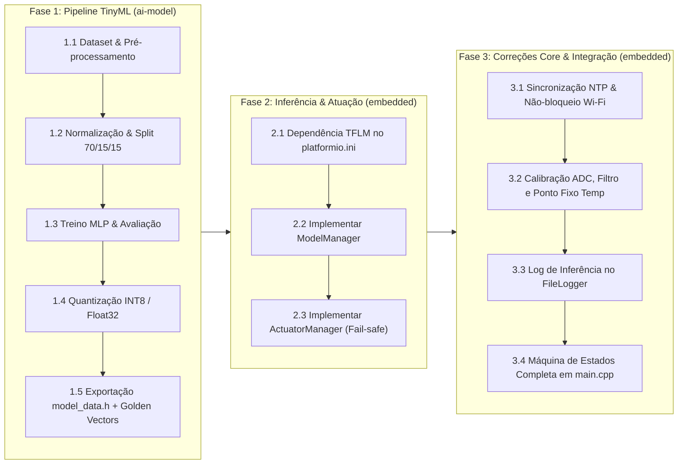

# Plano de Ação e Implementação: Modelo TinyML & Firmware ESP32

> **Escopo deste Documento:** Diagnóstico técnico das pendências reais de desenvolvimento e plano de implementação estruturado exclusivamente para o **Modelo de IA Embarcada (`ai-model/`)** e o **Firmware ESP32 (`embedded/`)**, ignorando o diretório `web/` e tarefas de interface web.

---

## 1. Diagnóstico do Estado Atual e Pendências Encontradas

A avaliação do código-fonte revelou que diversos itens marcados como `[x]` no arquivo `docs/TODO.md` estão parcialmente implementados ou possuem lacunas técnicas importantes que impedem o funcionamento completo em produção. Abaixo está o levantamento exaustivo dividido entre **Modelo de IA** e **Firmware Embarcado**.

### 1.1. Pendências no Modelo de IA (`ai-model/`)

Atualmente, o script `ai-model/train_tinyml.py` é apenas um protótipo inicial com dados sintéticos lineares. As pendências reais são:

1. **Ausência de Dataset Real / Limpeza de Dados (`[Pendente]`):**
   - `train_tinyml.py` utiliza `generate_synthetic_dataset()` com uma equação linear determinística (`score = (45 - soil)*1.5 + ...`). Não há carregamento nem pipeline de limpeza de datasets reais (como os levantados em `docs/DATASETS.md`) ou suporte a ingestão de dados CSV coletados pelo próprio ESP32 (`readings.csv`).
2. **Falta de Normalização / Escalonamento dos Inputs (`[Pendente Crítico]`):**
   - As features (`temp` [15..45], `humidity` [20..95], `soil` [5..90]) são passadas cruas (`raw`) para a rede neural.
   - Em `docs/TODO.md` exige-se normalização explícita (ex: Min-Max `[0, 1]` ou Z-Score) compartilhada entre o treino em Python e o pré-processamento em C++ no ESP32 (`ModelManager`).
3. **Divisão Incompleta de Dados (`[Pendente]`):**
   - O código faz apenas um *split* sequencial simples de 80/20 (Treino/Validação). Falta separação estratificada em **Treino, Validação e Teste** (ex: 70% / 15% / 15%), além de *shuffle* com semente fixa para reprodutibilidade.
4. **Treinamento e Avaliação de Métricas Insuficientes (`[Pendente]`):**
   - Não há callbacks (`EarlyStopping`, `ModelCheckpoint`, `ReduceLROnPlateau`).
   - Faltam métricas completas de validação e teste pós-treino: Matriz de Confusão, Precision, Recall, F1-Score, ROC-AUC, MAE/MSE e análise do limiar de decisão (*threshold tuning*).
5. **Quantização `int8` Incompleta (`[Pendente Crítico]`):**
   - O conversor atual usa apenas `converter.optimizations = [tf.lite.Optimize.DEFAULT]` sem fornecer um `representative_dataset`. Isso gera quantização híbrida/dinâmica em vez de **Full Integer Quantization (`int8`)**, que é o padrão ouro para o **TensorFlow Lite Micro (TFLM)** no ESP32 visando menor consumo de SRAM e Flash.
6. **Validação Cruzada de Inferência TFLite vs Keras (`[Pendente]`):**
   - Não há rotina em Python que instancie o `tf.lite.Interpreter` sobre o `model.tflite` gerado para medir a perda de precisão pós-quantização e gerar vetores de teste (*golden test vectors*) para validar a inferência C++ no ESP32.
7. **Integração Automática do Header C++ com o Firmware (`[Pendente]`):**
   - O script salva `output/model_data.h` dentro de `ai-model/output/` (que sequer foi gerado/versionado ainda), mas não exporta nem sincroniza automaticamente com `embedded/include/model_data.h`, nem exporta as constantes de normalização (`MIN`, `MAX`, `THRESHOLD`) no próprio header.

---

### 1.2. Pendências no Firmware Embarcado (`embedded/`)

1. **Módulo de Inteligência Artificial `ModelManager` Inexistente (`[Pendente Crítico]`):**
   - Não existem os arquivos `embedded/include/ModelManager.h`, `embedded/src/ModelManager.cpp` nem `embedded/include/model_data.h`.
   - Nenhuma biblioteca de inferência TensorFlow Lite Micro (ex: `EloquentTinyML`, `tflite-micro-esp32` ou ` Chirale_TensorFlowLite`) está declarada no `embedded/platformio.ini`.
   - Falta implementar a alocação do `tensor_arena`, carregamento do modelo, normalização das leituras de `SensorsManager::SensorData`, execução da inferência e retorno da probabilidade + decisão booleana.
2. **Módulo de Atuação `ActuatorManager` Inexistente (`[Pendente Crítico]`):**
   - O controle do relé/válvula está hardcoded diretamente dentro do `loop()` em `main.cpp` com uma regra estática (`if (data.soilMoisture < 30)`).
   - Falta criar `ActuatorManager.h` e `ActuatorManager.cpp` com:
     - Controle seguro de estado da válvula/bomba e LED de status.
     - **Proteções de segurança hidráulica/elétrica**: tempo máximo de irrigação contínua (*timeout* contra inundação/travamento), tempo mínimo de espera entre acionamentos (*cooldown* para infiltração da água no solo) e desativação de emergência (*fail-safe*) caso os sensores retornem erro.
3. **Máquina de Estados (`SystemState`) Declarada mas Não Utilizada (`[Divergência TODO vs Código]`):**
   - Embora marcado como `[x]` no `docs/TODO.md`, o `enum class SystemState { INIT, READ_SENSORS, RUN_INFERENCE, EXECUTE_ACTION, ERROR }` em `main.cpp` só recebe `INIT` e `READ_SENSORS`, sem nenhuma estrutura `switch (currentState)` conduzindo o fluxo de leitura $\rightarrow$ inferência $\rightarrow$ atuação $\rightarrow$ tratamento de falha.
4. **Log de Inferência (`inference.csv`) Não Implementado em `FileLogger` (`[Incompleto]`):**
   - `FileLogger::begin()` cria o arquivo `/littlefs/inference.csv` com cabeçalho `"inference_result, timestamp"`, mas o método template `FileLogger::logData<T>()` só aceita `SensorsManager::SensorData`. Não existe struct `InferenceData` nem especialização em `logData` para registrar as predições da IA e o acionamento da válvula.
5. **Sincronização NTP Ausente no `NetworkManager` (`[Divergência TODO vs Código]`):**
   - Marcado como `[x]` em `docs/TODO.md` (*"Sincronizar o relógio interno do ESP32 com o servidor NTP (`pool.ntp.org`) apenas uma vez após a conexão Wi-Fi"*), porém **não há nenhuma chamada a `configTime()`** em todo o código. Como consequência, `getFormattedTimestamp()` em `Utils.cpp` sempre detecta `tm_year < 120` (ano 1970) e retorna `nullptr`, gravando `"0000-00-00 00:00:00"` em todos os logs CSV.
6. **Persistência de Calibração e Precisão de Sensores (`[Divergência TODO vs Código]`):**
   - **Temperatura em Ponto Fixo:** O `TODO.md` marca `[x]` para *"converter para ponto fixo `int16_t` (multiplicado por 10) para preservar 1 casa decimal"*, mas `SensorsManager` usa `int8_t` truncando casas decimais com `round(t)`.
   - **Calibração do Sensor de Solo (HW-080):** O `TODO.md` marca `[x]` para *"mecanismo para salvar configurações de calibração sem precisar regravar o firmware"*, porém `getSoilMoisture()` faz `map(rawValue, 4095, 0, 0, 100)` fixo no código, sem valores de calibração seco/úmido (`ADC_DRY`, `ADC_WET`) persistidos em `Preferences` (NVS) ou `LittleFS`, nem filtro de média móvel/mediana para reduzir ruído do ADC do ESP32.
   - **Bloqueio de Rede em `NetworkManager::reconnect()`:** Possui um `while (WiFi.status() != WL_CONNECTED && millis() - start < 15000) { delay(100); }` que trava a CPU por até 15 segundos caso o Wi-Fi caia, podendo atrasar o desligamento da válvula de irrigação.

---

## 2. Plano de Ação e Implementação (Passo a Passo)

A estratégia de execução prioriza primeiro o fechamento completo do pipeline de **Inteligência Artificial (TinyML)** — garantindo que o modelo, os parâmetros de normalização e os vetores de teste estejam prontos e validados — para em seguida construir os módulos de inferência, atuação e correções estruturais no **Firmware do ESP32**.



---

### FASE 1: Desenvolvimento e Exportação do Modelo de IA (`ai-model/`)

> **Decisões de Arquitetura Consolidadas (Design Review):**
> 1. **Foco Agronômico Inicial em Hortaliças + Suporte Multicltura:** Priorizar o comportamento das hortaliças (`Tomato`, `Chilli`, `Carrot`, `Potato` — comuns na agricultura familiar de Paulista-PE) como perfil padrão quando a cultura não for informada, mantendo suporte às demais culturas quando especificadas.
> 2. **Classificação Multiclasse de 3 Estados (`Softmax`):**
>    - `Classe 0 (OFF)`: Umidade adequada $\rightarrow$ Válvula fechada.
>    - `Classe 1 (IRRIGATE)`: Necessidade hídrica $\rightarrow$ Válvula aberta.
>    - `Classe 2 (THERMAL_STRESS_WET_SOIL)`: Calor extremo ($>32\text{ °C}$) com solo já úmido ($\approx 68\%$) $\rightarrow$ Válvula mantida **fechada** (evita asfixia radicular) e **alerta de estresse térmico** gravado no log CSV (`inference.csv`) e reportado no status do sistema.
> 3. **Contexto Agronômico Opcional (*Context Dropout / Fallback Não-Bloqueante*):**
>    - O modelo aceita as **3 leituras obrigatórias dos sensores** (`temp`, `humidity`, `MOI`) + **3 parâmetros opcionais de contexto** (`soil_type`, `crop ID`, `Seedling Stage`).
>    - **Jamais bloqueia a execução:** Durante o treino, aplica-se *Context Dropout* (mascarando aleatoriamente `soil_type`, `crop ID` e/ou `Seedling Stage` com o índice `0 = UNKNOWN`). Assim, se o usuário no ESP32 informar todos os dados, a separabilidade chega a $100\%$; se informar apenas o solo ($96,1\%$) ou **não informar absolutamente nada** (usando apenas os 3 sensores físicos), a rede neural roda normalmente com fallback seguro para o perfil de hortaliças.
> 4. **Adaptação Dupla em Campo:**
>    - **Em Memória Local (`LittleFS`):** Arquivo de configuração persistente (`/littlefs/config.cfg` ou JSON/CSV) armazena `soil_type`, `crop_id`, `seedling_stage`, `confidence_threshold` e calibração do ADC (`ADC_DRY`, `ADC_WET`) sem precisar regravar o firmware.
>    - **Ciclo de Re-treinamento (*Fine-Tuning*):** Os logs `/littlefs/readings.csv` e `/littlefs/inference.csv` coletados em campo em Paulista-PE seguem o formato exato para alimentar futuros re-treinamentos no `train_tinyml.py`.

#### Etapa 1.1 — Estruturação de Dados, Codificação de Contexto e *Context Dropout*
* **Objetivo:** Carregar `ai-model/datasets/Smart Agriculture Dataset/cropdata_updated.csv` (`16.411` registros, `0` nulos) e preparar o dataset com suporte a contexto opcional.
* **Ações:**
  1. Mapear as categorias de contexto para índices inteiros com reserva do índice `0` para **`UNKNOWN` (Não Informado)**:
     - `soil_type` (`0 = UNKNOWN`, `1..7` = `Clay`, `Sandy`, `Red`, `Loam`, `Black`, `Alluvial`, `Chalky`).
     - `crop ID` (`0 = UNKNOWN / Default Hortaliças`, `1..5` = `Tomato`, `Chilli`, `Carrot`, `Potato`, `Wheat`).
     - `Seedling Stage` (`0 = UNKNOWN`, `1..8` = `Germination` até `Harvest`).
  2. **Data Augmentation com *Context Dropout*:** Para cada amostra original (focando nas hortaliças quando `crop ID == UNKNOWN`), gerar variações no conjunto de treino onde `(soil_type, crop ID, Seedling Stage)` são parcial ou totalmente substituídos por `0` (`UNKNOWN`). Isso ensina a rede neural a operar tanto com contexto completo ($100\%$ de separabilidade) quanto apenas com os 3 sensores físicos.
  3. Manter as **3 classes da variável alvo (`result`)**: `0` (Não Irrigar), `1` (Irrigar) e `2` (Alerta de Estresse Térmico com Solo Úmido).

#### Etapa 1.2 — Normalização Explícita e Divisão Estratificada (70% / 15% / 15%)
* **Objetivo:** Garantir entradas normalizadas em `[0.0, 1.0]` com parâmetros exportáveis para o C++ do ESP32.
* **Ações:**
  1. Normalizar as 3 variáveis contínuas de sensores via Min-Max explícito:
     - `TEMP_MIN = 0.0f`, `TEMP_MAX = 50.0f`
     - `HUMIDITY_MIN = 0.0f`, `HUMIDITY_MAX = 100.0f`
     - `SOIL_MIN = 0.0f`, `SOIL_MAX = 100.0f`
  2. Codificar as variáveis opcionais de contexto (normalizadas ou *One-Hot / Embedding* compacto, onde `UNKNOWN` = vetor zero) para que a ausência de contexto resulte matematicamente em contribuição neutra na primeira camada densa (`Dense`).
  3. Dividir o dataset original de forma estratificada (`train_test_split` pela combinação `crop ID + result`) antes do *Context Dropout* (evitando *data leakage*) em:
     - **70% Treino**
     - **15% Validação**
     - **15% Teste** (avaliado em 3 cenários: *Sem Contexto [Só Sensores]*, *Contexto Parcial [Só Solo]* e *Contexto Completo*).

#### Etapa 1.3 — Treinamento Multiclasse (`Softmax`), Balanceamento e Métricas
* **Objetivo:** Treinar a rede MLP para distinguir com alta precisão as classes `0`, `1` e `2`.
* **Ações:**
  1. Definir arquitetura MLP compatível com TFLite Micro:
     - `Input` (3 sensores contínuos + features de contexto opcionais) $\rightarrow$ `Dense(24, activation='relu')` $\rightarrow$ `Dense(12, activation='relu')` $\rightarrow$ `Dense(3, activation='softmax')`.
  2. Utilizar função de perda `sparse_categorical_crossentropy` (ou `categorical_crossentropy`) com `class_weight` balanceado para compensar a menor frequência da Classe `2` ($6,84\%$ do dataset), acompanhado de `EarlyStopping` e `ReduceLROnPlateau`.
  3. Gerar relatório de validação no conjunto de **Teste** contendo:
     - Acurácia Global e por Cenário de Contexto (*0 contextos*, *apenas solo*, *contexto completo*).
     - Precision, Recall e F1-Score por classe (`0: OFF`, `1: IRRIGATE`, `2: THERMAL_STRESS`).
     - Matriz de Confusão $3 \times 3$.

#### Etapa 1.4 — Quantização TFLite (`int8` / Otimizado) e Validação Cruzada
* **Objetivo:** Comprimir o modelo para o ESP32 e validar a fidelidade numérica no `tf.lite.Interpreter`.
* **Ações:**
  1. Implementar `representative_data_gen()` cobrindo amostras com e sem contexto agronômico para calibrar a quantização.
  2. Converter para `model.tflite` e comparar as probabilidades `Softmax` `[P(0), P(1), P(2)]` do `.tflite` contra o modelo Keras original (divergência máxima $< 1\%$).
  3. Extrair *Golden Test Vectors* para as 3 classes (com e sem contexto) para validação automatizada no ESP32.

#### Etapa 1.5 — Exportação Automatizada para o Firmware (`model_data.h`)
* **Objetivo:** Gerar o cabeçalho C/C++ autocontido em `ai-model/output/model_data.h` e `embedded/include/model_data.h`.
* **Ações:**
  1. Exportar `g_model_data[]` e `g_model_len`.
  2. Exportar `enum`s C++ com os códigos de `SoilType`, `CropType`, `SeedlingStage` (todos iniciando em `0 = UNKNOWN`), constantes `TEMP_MIN/MAX`, `HUM_MIN/MAX`, `SOIL_MIN/MAX`, `DEFAULT_CONFIDENCE_THRESHOLD` e os *Golden Test Vectors*.

---

### FASE 2: Implementação dos Módulos de IA, Contexto e Atuação no Firmware (`embedded/`)

#### Etapa 2.1 — Configuração do TensorFlow Lite Micro no PlatformIO
* **Objetivo:** Integrar a biblioteca TFLite Micro ao `embedded/platformio.ini` compatível com C++17.
* **Ações:**
  1. Adicionar dependência TFLite Micro no `platformio.ini` e validar o tamanho do binário na partição `app0` (`1.72 MB`).

#### Etapa 2.2 — Criação do `ModelManager` com Suporte a Contexto Opcional e 3 Estados
* **Objetivo:** Executar a inferência multiclasse no ESP32 mesmo quando o usuário não fornecer dados de solo/cultura.
* **Ações:**
  1. Definir estruturas de contexto e resultado em `ModelManager.h`:
     ```cpp
     enum class IrrigationDecision : uint8_t {
       OFF = 0,                      // Classe 0: Não irrigar
       IRRIGATE = 1,                 // Classe 1: Acionar irrigação
       THERMAL_STRESS_WET_SOIL = 2   // Classe 2: Solo já úmido sob calor alto (Não irrigar + Alerta)
     };

     struct AgronomicContext {
       uint8_t soilType = 0;         // 0 = UNKNOWN (Opcional)
       uint8_t cropId = 0;           // 0 = UNKNOWN / Default Hortaliças (Opcional)
       uint8_t seedlingStage = 0;    // 0 = UNKNOWN (Opcional)
       float confidenceThreshold = 0.55f;
     };

     struct InferenceResult {
       IrrigationDecision decision;
       float probabilities[3];       // [P(OFF), P(IRRIGATE), P(THERMAL_STRESS)]
       float confidence;             // Probabilidade da classe vencedora
       bool shouldIrrigate;          // true APENAS se decision == IRRIGATE e confidence >= threshold
       bool thermalStressAlert;      // true se decision == THERMAL_STRESS_WET_SOIL
       bool valid;                   // true se sensores válidos e inferência OK
       char timestamp[20];
     };
     ```
  2. Implementar `MicroMutableOpResolver` com as operações `AddFullyConnected`, `AddRelu` e `AddSoftmax`.
  3. Implementar `predict(const SensorsManager::SensorData &data, const AgronomicContext &ctx = AgronomicContext{})`:
     - Nunca bloquear se `ctx.soilType == 0`, `ctx.cropId == 0` ou `ctx.seedlingStage == 0`; codificar campos ausentes como neutros (`UNKNOWN`) e executar a inferência normalmente.
     - Adicionar fallback físico complementar: se a rede prever `IRRIGATE`, mas `data.soilMoisture` já estiver acima do teto de segurança configurável (ex: $65\%$) com `data.temperature >= 32°C`, reclassificar preventivamente para `THERMAL_STRESS_WET_SOIL`.

#### Etapa 2.3 — Criação do `ActuatorManager` (`ActuatorManager.h` / `ActuatorManager.cpp`)
* **Objetivo:** Controlar a válvula solenoide/relé e sinalização de status/alerta com travas físicas de segurança.
* **Ações:**
  1. Acionar a válvula **somente** quando `InferenceResult::shouldIrrigate == true` (`decision == IRRIGATE`).
  2. Quando `decision == THERMAL_STRESS_WET_SOIL` (Classe 2), garantir que a válvula permaneça **fechada** e emitir sinalização de alerta de estresse térmico (no log e no LED/telemetria).
  3. Implementar travas não-bloqueantes baseadas em `millis()`:
     - `MAX_IRRIGATION_DURATION_MS` (*timeout* máximo contínuo contra alagamento).
     - `MIN_COOLDOWN_DURATION_MS` (*cooldown* entre regas para percolação da água no solo).
     - `emergencyStop()` imediato em caso de erro de leitura dos sensores.

---

### FASE 3: Correções Estruturais e Integração da Máquina de Estados (`embedded/`)

#### Etapa 3.1 — Sincronização NTP e Reconexão Wi-Fi Não-Bloqueante (`NetworkManager`)
* **Objetivo:** Garantir timestamps reais nos logs CSV e impedir que quedas de Wi-Fi congelem o controle da válvula.
* **Ações:**
  1. Em `NetworkManager`, configurar NTP (`configTime(-3 * 3600, 0, "pool.ntp.org", "time.nist.gov")`) assim que a conexão Wi-Fi for detectada pela primeira vez.
  2. Remover o loop bloqueante de 15 segundos (`while (...) delay(100);`) de `NetworkManager::reconnect()`, tornando a tentativa de reconexão assíncrona baseada em `millis()`.

#### Etapa 3.2 — Aperfeiçoamento do `SensorsManager` (Ponto Fixo, Filtro ADC e Calibração)
* **Objetivo:** Alinhar o código com os requisitos do `TODO.md` e aumentar a confiabilidade das leituras físicas.
* **Ações:**
  1. **Filtro de Leitura ADC:** Realizar múltiplas amostras (ex: 10 leituras espaçadas ou média aparada) em `getSoilMoisture()` para estabilizar a leitura analógica do GPIO 32.
  2. **Calibração Persistente:** Adicionar constantes `SOIL_ADC_DRY` e `SOIL_ADC_WET` em `config.h` e permitir carregamento/salvamento de calibração no `LittleFS` (`/littlefs/calibration.cfg`) ou NVS (`Preferences`).
  3. **Temperatura em Ponto Fixo (`int16_t`):** Atualizar `SensorData::temperature` para `int16_t` armazenando `round(t * 10)` (ex: `254` = `25.4 °C`, sentinela de erro `-999`), ou converter para `float` (`temperature / 10.0f`) no momento de alimentar o `ModelManager`.

#### Etapa 3.3 — Registro de Inferências no `FileLogger`
* **Objetivo:** Habilitar a gravação e leitura do arquivo `/littlefs/inference.csv`.
* **Ações:**
  1. Estender `FileLogger::logData<T>()` em `FileLogger.h` para aceitar `ModelManager::InferenceResult` (ou struct `InferenceLogData`), gravando `temperatura,umidade,umidade_solo,probabilidade,decisao,timestamp` em `/littlefs/inference.csv`.

#### Etapa 3.4 — Integração da Máquina de Estados em `main.cpp`
* **Objetivo:** Unificar todos os módulos num fluxo determinístico, seguro e rastreável.
* **Ações:**
  1. Implementar o `switch (currentState)` real no `loop()` de `main.cpp`:
     - `SystemState::INIT`: Verifica inicialização do LittleFS, Sensores, Modelo TFLite e Atuadores.
     - `SystemState::READ_SENSORS`: No intervalo temporizado, lê sensores, valida sentinelas de erro (`-999` / `255`) e grava no `FileLogger`. Se leitura inválida $\rightarrow$ `SystemState::ERROR`; se válida $\rightarrow$ `SystemState::RUN_INFERENCE`.
     - `SystemState::RUN_INFERENCE`: Executa `modelManager.predict(sensorData)`, grava resultado no `inference.csv` e avança para `SystemState::EXECUTE_ACTION`.
     - `SystemState::EXECUTE_ACTION`: Passa a decisão ao `actuatorManager`, respeitando *cooldown* e *timeout*, e retorna ao estado de espera até o próximo ciclo de `READ_SENSORS`.
     - `SystemState::ERROR`: Aciona `actuatorManager.emergencyStop()` (fecha válvula imediatamente), pisca `STATUS_LED` em padrão de alerta, registra falha e agenda nova tentativa de leitura no próximo ciclo.

---

## 3. Checklist Resumido de Execução

- [ ] **Passo 1:** Refatorar `ai-model/train_tinyml.py` (Dataset realista/CSV, normalização explícita `[0,1]`, split 70/15/15, métricas completas).
- [ ] **Passo 2:** Implementar quantização com `representative_dataset`, validação no `tf.lite.Interpreter` e geração automática de `embedded/include/model_data.h`.
- [ ] **Passo 3:** Executar o pipeline Python, validar métricas e confirmar geração do header C++.
- [ ] **Passo 4:** Configurar biblioteca TFLite Micro no `embedded/platformio.ini` e implementar `ModelManager.h` / `ModelManager.cpp`.
- [ ] **Passo 5:** Implementar `ActuatorManager.h` / `ActuatorManager.cpp` com proteções de *timeout*, *cooldown* e *fail-safe*.
- [ ] **Passo 6:** Corrigir `NetworkManager` (adicionar sync NTP com `configTime` e remover bloqueio de 15s no `reconnect()`).
- [ ] **Passo 7:** Atualizar `SensorsManager` (ponto fixo `int16_t` para temperatura, multisampling no ADC e calibração persistente) e `FileLogger` (suporte ao `inference.csv`).
- [ ] **Passo 8:** Implementar a Máquina de Estados completa em `embedded/src/main.cpp` e validar a compilação do firmware via PlatformIO.
