# Auditoria Técnica Profunda: Notebook TinyML (`train_tinyml_colab.ipynb`), Arquiteturas Alternativas e Benchmark Embarcado (ESP32)

> **Escopo:** Análise forense completa de [`train_tinyml_colab.ipynb`](file:///home/victor/projects/sistema-de-irrigacao-inteligente/ai-model/train_tinyml_colab.ipynb), diagnóstico de bugs de sintaxe, treinamento, validação, quantização e integração com o firmware ESP32, além de benchmark experimental de **10 arquiteturas alternativas** e **12 pranchas gráficas** geradas via `matplotlib`.

---

## 1. Diagnóstico de Erros, Bugs de Treinamento, Validação e Lógica

A auditoria linha a linha do notebook original revelou **9 problemas críticos** divididos em 4 categorias:

### A. Bug de Sintaxe Fatal (`SyntaxError`)
1. **Célula 12 (Linha 326 do `.ipynb`):**
   - **Código original:** `print(f"\n{=*75}\nAvaliação: {mode_name} (n={len(y_s)})\n{=*75}")`
   - **Problema:** Em Python, `{=*75}` dentro de uma f-string gera `SyntaxError: f-string: valid expression required before '='`, impedindo a execução de toda a célula de avaliação e plotagem.

### B. Bugs Críticos de Validação e Vazamento de Dados (*Data Leakage*)
2. **Ausência de Deduplicação Pré-Split (128 linhas idênticas):**
   - O dataset [`cropdata_updated.csv`](file:///home/victor/projects/sistema-de-irrigacao-inteligente/ai-model/datasets/Smart%20Agriculture%20Dataset/cropdata_updated.csv) possui `16.411` linhas, das quais **128 são duplicatas 100% exatas** (256 linhas envolvidas). Sem `df.drop_duplicates()`, registros idênticos vazam simultaneamente para Treino, Validação e Teste.
3. **Vazamento Massivo de Tuplas de Sensores (`91,85%` de *Sensor-Tuple Leakage*):**
   - Existem apenas **`2.886` tuplas únicas `(MOI, temp, humidity)`** nas `16.283` linhas únicas (média de `5,64` ocorrências por tupla, replicadas entre culturas/estágios).
   - No `train_test_split` estratificado por linha, **`2.244 / 2.443` (`91,85%`) das tuplas de sensores do Teste já estavam no Treino**. Ao mascarar o contexto nos Modos 3 e 4, o teste avalia combinações físicas já memorizadas. A avaliação rigorosa via **GroupSplit por `(MOI, temp, humidity)`** mede a generalização real para leituras inéditas.
4. **Validação Distorcida (`is_training=True` no `val_df`):**
   - O notebook aplicava `build_augmented_dataset(val_df, is_training=True)`, multiplicando hortaliças por 4x e filtrando a Classe 2 (`m >= 60.0`) no conjunto de validação, distorcendo a `val_loss` monitorada pelo `EarlyStopping` e `ReduceLROnPlateau`.

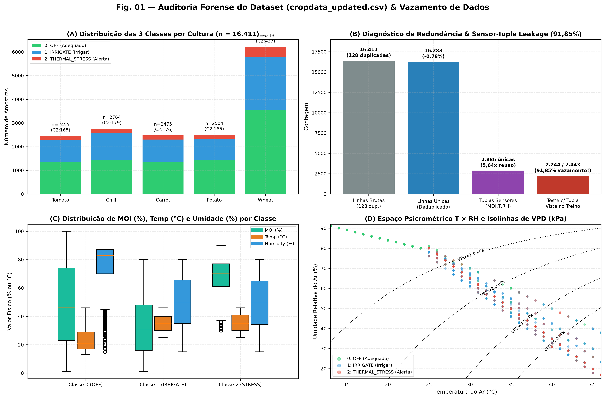

### C. Bugs Críticos de Treinamento e Lógica Estatística
5. **Colapso de Precisão da Classe 2 (`THERMAL_STRESS`) pela Combinação `class_weight="balanced"` + *Context Dropout* Assimétrico:**
   - O *Context Dropout* original replicava `Wheat` por **2x**, Hortaliças Classes `0/1` por **4x** e Classe `2` (`MOI < 60`) por **3x**. Em seguida, `compute_class_weight("balanced")` atribuía peso **`~5.05`** à Classe 2 vs **`~0.60`** à Classe 0 (**8,4x maior**).
   - No Modo Zero Contexto, onde há sobreposição física entre Classe 0 (`971` amostras com `MOI>=60, T>=32`) e Classe 2 (`603` amostras), esse peso excessivo derrubou a **Precisão da Classe 2 para `34,25%`** (mais de 65% de alarmes falsos!) e elevou o erro de calibração (**ECE = `0.0676`** vs `0.0143` na `ResMLP-Tiny`).
6. **Cobertura Incompleta das Máscaras de Contexto (*Missing `Crop-Only` Mask* `[0, C, 0]`):**
   - Das $2^3 = 8$ combinações possíveis de `(Soil, Crop, Stage)`, o notebook só treinava 4. Nunca treinava **`[0, crop_id, 0]`** (agricultor sabe que plantou Tomate, mas não sabe classificar o solo geologicamente entre *Alluvial*, *Black*, *Chalky*, etc.). Isso derrubava a acurácia do modelo original nesse modo para **`83,27%`** (`F1 = 73,37%`), contra **`89,44%`** (`ResMLP-Tiny`) e **`89,28%`** (`PhysMLP-27`).
7. **Ausência de Engenharia de Atributos Psicrométricos (*VPD* e Acoplamento Hidro-Térmico):**
   - A evapotranspiração e o estresse térmico são governados pelo **Déficit de Pressão de Vapor ($VPD$, kPa)** e por razões não-lineares entre temperatura, umidade do ar e umidade do solo.

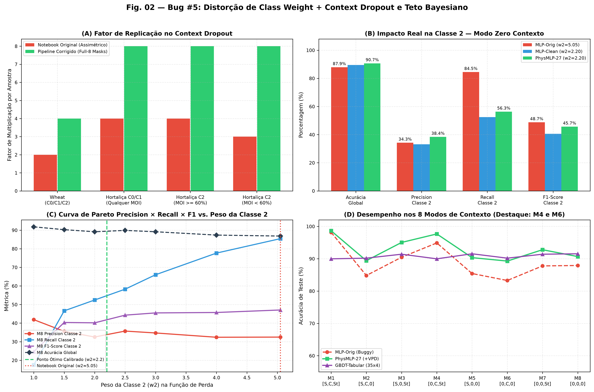

### D. Bugs de Quantização TinyML e Integração com o Firmware ESP32
8. **Falsa Quantização no `TFLiteConverter`:**
   - Usar `converter.optimizations = [tf.lite.Optimize.DEFAULT]` **sem `representative_dataset`** em uma MLP pequena faz o TFLite manter **100% dos pesos e ativações em `float32`** (`7.620` bytes no `MLP-Orig`, idêntico ao `Float32` puro!).
   - Com **Full Integer Quantization (`INT8`)** e `representative_dataset`, o tamanho cai para **`5.272`–`5.400` bytes** (ou **`3.824` bytes** na `MLP-Nano`), mantendo **`98,83%`–`99,33%`** de concordância de decisão.
9. **Risco Silencioso com Sentinelas de Falha do Hardware ([`SensorsManager.cpp`](file:///home/victor/projects/sistema-de-irrigacao-inteligente/embedded/src/SensorsManager.cpp)):**
   - `SensorsManager` retorna `-128` (`int8_t`) para temperatura e `255` (`uint8_t`) para umidade quando o DHT22 falha (`isnan`). Sem validação explícita antes do `np.clip` / `std::clamp`, `-128 °C` vira `0.0` ($0\text{ °C}$) e `255%` vira `1.0` ($100\%$), mascarando a falha do sensor como "clima frio e úmido (`OFF`)".

---

## 2. Comparativo Experimental das 10 Arquiteturas Alternativas

Todas as arquiteturas foram avaliadas sob o mesmo conjunto de teste deduplicado (`te_clean`) nos **8 modos de contexto**, além de `GroupSplit` (Zero Leakage) e quantização `INT8`:

| Arquitetura | M1 Completo Acc / F1 | M6 Só Cultura `[0,C,0]` Acc / F1 | M8 Zero Contexto Acc / F1 | C2 Prec / Rec (M8) | ECE (M8) | Flash INT8 / Nós |
| :--- | :---: | :---: | :---: | :---: | :---: | :---: |
| **MLP-Orig (Buggy)** | 98,17% / 95,24% | 83,27% / 73,37% | 87,91% / 78,34% | 34,25% / 84,47% | 0,0676 | 7.620 B *(F32)* |
| **MLP-Clean (32-16)** | **98,73% / 96,49%** | 88,70% / 76,86% | 89,48% / 76,14% | 33,13% / 52,43% | 0,0276 | 5.320 B |
| **MLP-Nano (16-8)** | 96,44% / 91,48% | 87,43% / 72,84% | 89,94% / 76,20% | 34,48% / 48,54% | 0,0229 | **3.824 B** |
| **MLP-Deep-BN (64-32-16)** | 98,04% / 94,97% | 89,07% / 77,28% | 89,94% / **78,51%** | 37,50% / 64,08% | 0,0297 | 10.712 B |
| **ResMLP-Tiny** | 98,20% / 95,11% | **89,44%** / 77,41% | 90,60% / 77,10% | 37,04% / 48,54% | **0,0143** | 6.080 B |
| **PhysMLP-27 (+VPD)** | 98,65% / 96,32% | 89,28% / **77,43%** | **90,67%** / 78,29% | **38,41%** / 56,31% | 0,0145 | 5.400 B |
| **Modality-Gated TinyNet** | 97,50% / 93,59% | 88,58% / 76,76% | 90,47% / 76,80% | 36,23% / 48,54% | 0,0218 | 7.448 B |
| **CART-Tree (Depth 9)** | 94,72% / 88,23% | 89,03% / — | 90,01% / 77,62% | 36,36% / 58,25% | 0,0235 | 253 nós (`0 B` arena) |
| **RandomForest (15x8)** | 90,99% / 80,85% | 89,07% / — | 90,14% / 78,00% | 36,69% / 60,19% | 0,0311 | 2.871 nós (`0 B` arena) |
| **GBDT-Tabular (35x4)** | 89,97% / 63,87% | 90,18% / — | 91,53% / 65,00% | 60,00% / 2,91% | 0,0792 | 2.155 nós |

### Generalização Estrita (`GroupSplit` — Zero Sobreposição de Tuplas `(MOI, Temp, Hum)`):
- **`MLP-Clean (32-16)`:** `M1 = 97,47%` | `M6 = 87,26%` | `M8 = 87,35%` (`F1 = 74,30%`)
- **`PhysMLP-27 (+VPD)`:** `M1 = 97,76%` | `M6 = 86,80%` | `M8 = 85,64%` (`F1 = 74,51%`)
- **`GBDT-Tabular (35x4)`:** `M1 = 88,42%` | `M6 = 88,42%` | `M8 = 89,66%` (`F1 = 23,25%` na versão sem pesos)

---

## 3. Painel Visual Completo (12 Pranchas em `matplotlib`)

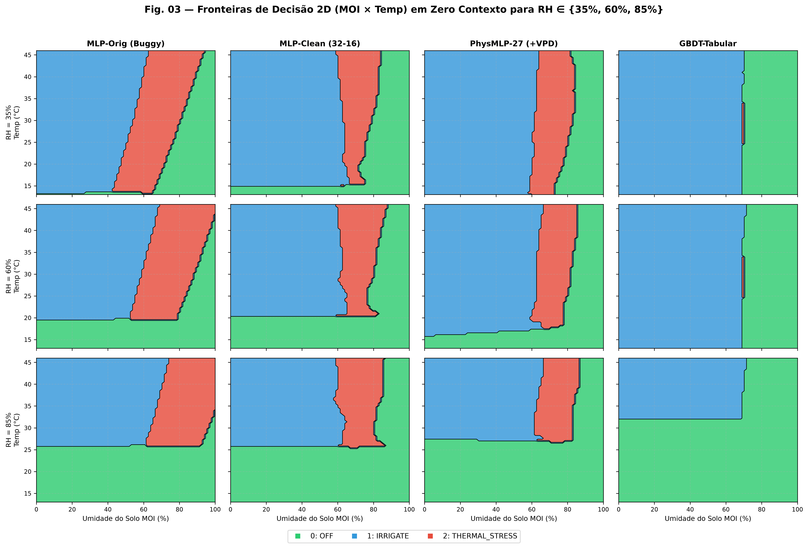
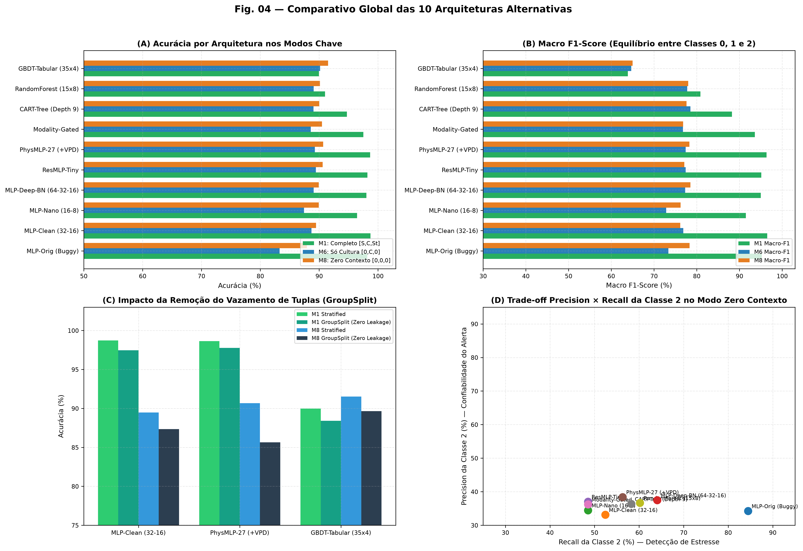
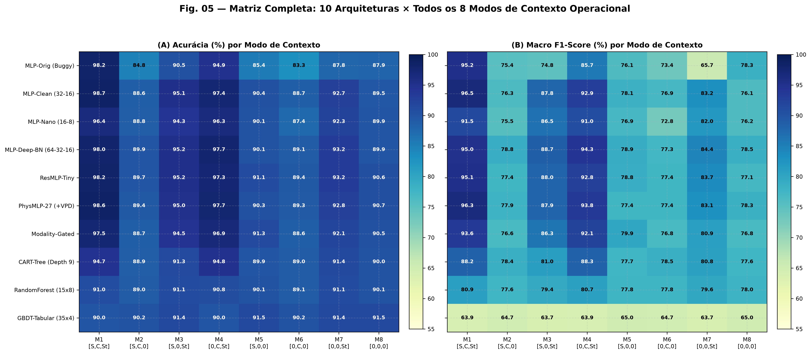
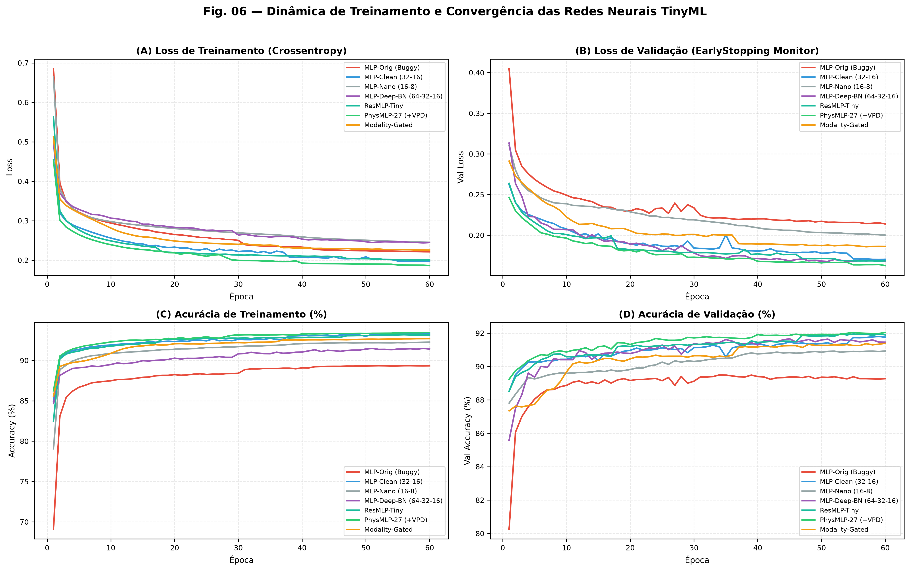
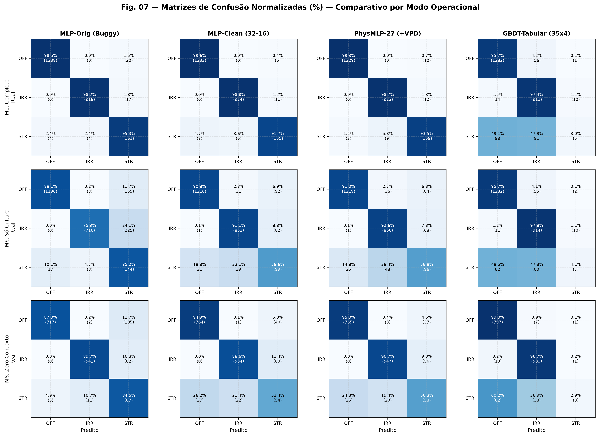
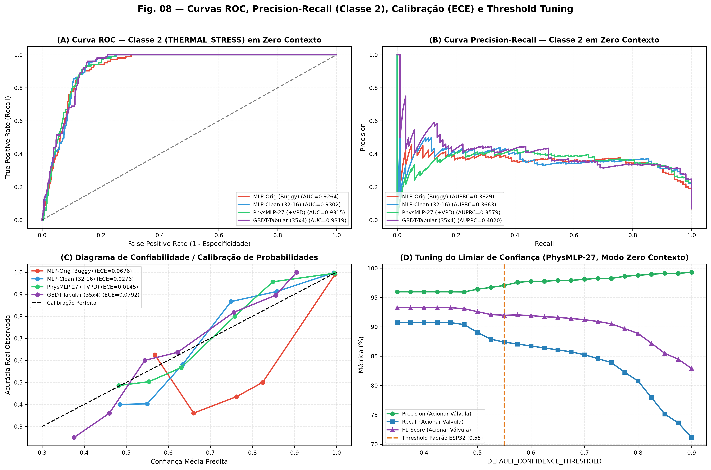
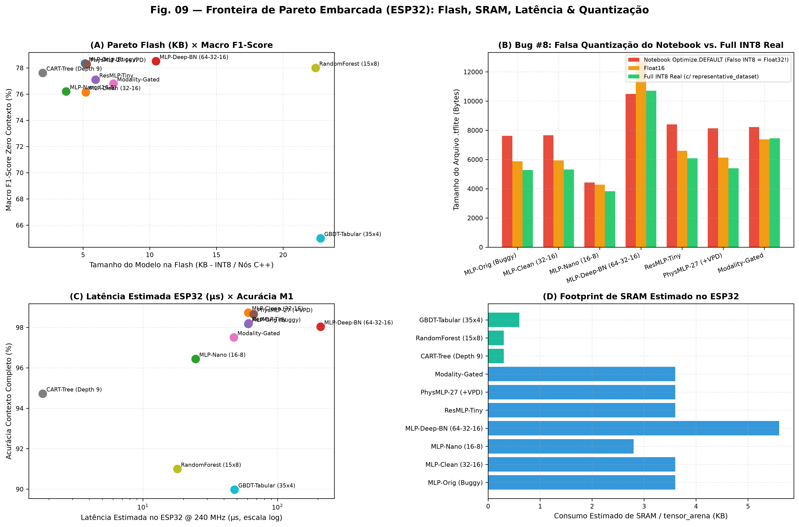
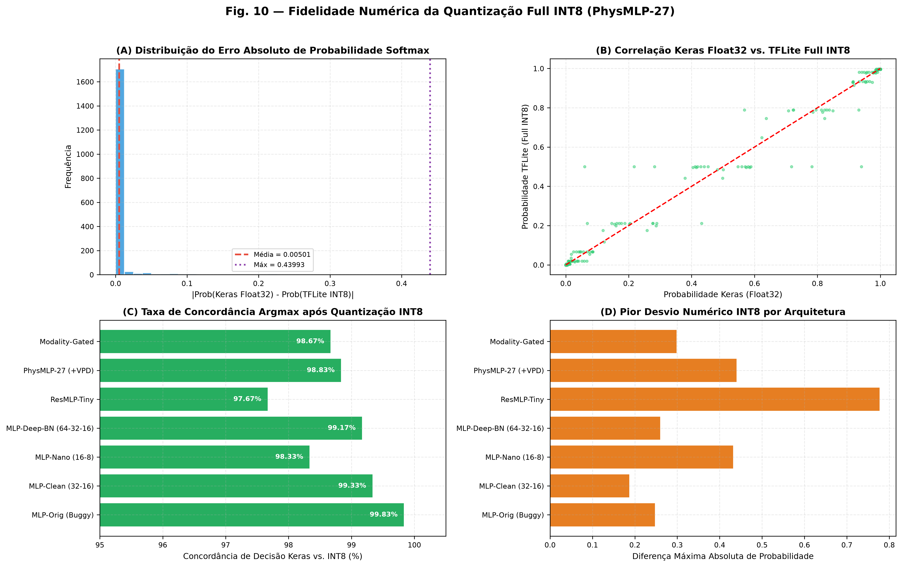
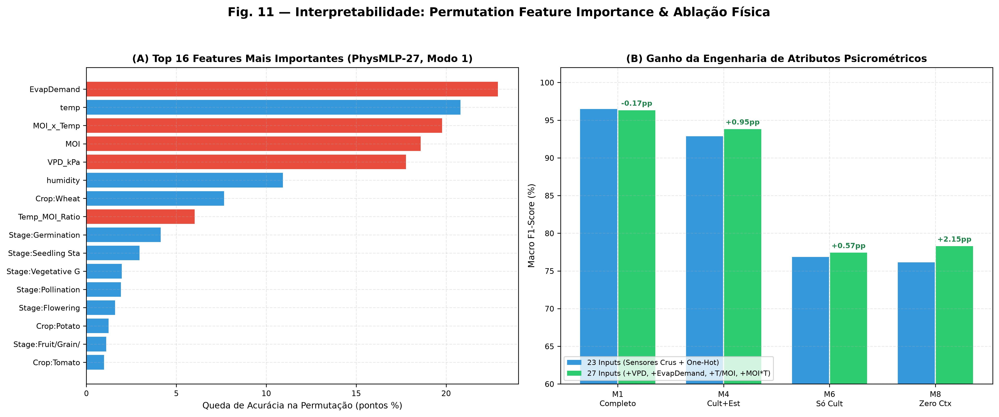
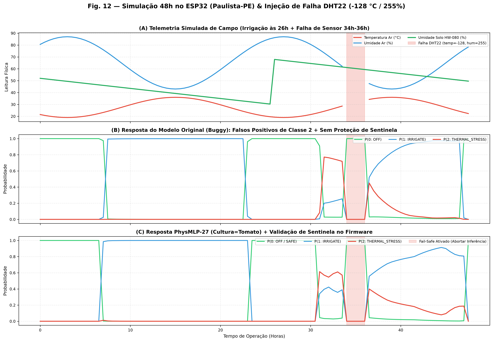

---

## 4. Implementação e Resultados Consolidados da Versão 2 (`train_tinyml_v2`)

Com base nos 9 problemas diagnosticados na Seção 1 e no benchmark de arquiteturas da Seção 2, foi implementada e executada a **v2 oficial do pipeline de treinamento TinyML (`PhysMLP-27` Full INT8)**:

- **Script Python v2:** [`ai-model/train_tinyml_v2.py`](file:///home/victor/projects/sistema-de-irrigacao-inteligente/ai-model/train_tinyml_v2.py)
- **Notebooks Colab/Jupyter v2:** [`ai-model/train_tinyml_v2_colab.ipynb`](file:///home/victor/projects/sistema-de-irrigacao-inteligente/ai-model/train_tinyml_v2_colab.ipynb) e [`ai-model/train_tinyml_colab.ipynb`](file:///home/victor/projects/sistema-de-irrigacao-inteligente/ai-model/train_tinyml_colab.ipynb)
- **Modelos TFLite Exportados:** [`ai-model/output/model_int8.tflite`](file:///home/victor/projects/sistema-de-irrigacao-inteligente/ai-model/output/model_int8.tflite) (`5.480 bytes`) e [`ai-model/output/model_float32.tflite`](file:///home/victor/projects/sistema-de-irrigacao-inteligente/ai-model/output/model_float32.tflite) (`8.216 bytes`)
- **Headers C/C++ (`model_data.h`) Sincronizados:** [`ai-model/output/model_data.h`](file:///home/victor/projects/sistema-de-irrigacao-inteligente/ai-model/output/model_data.h), [`ai-model/model_data.h`](file:///home/victor/projects/sistema-de-irrigacao-inteligente/ai-model/model_data.h) e [`embedded/include/model_data.h`](file:///home/victor/projects/sistema-de-irrigacao-inteligente/embedded/include/model_data.h)
- **Relatório JSON da Execução v2:** [`ai-model/output/train_tinyml_v2_report.json`](file:///home/victor/projects/sistema-de-irrigacao-inteligente/ai-model/output/train_tinyml_v2_report.json)

### 4.1. Mapeamento das 9 Correções Aplicadas na v2

| # | Achado da Auditoria (`v1 Buggy`) | Solução Implementada no `train_tinyml_v2` (`PhysMLP-27`) | Resultado Medido na v2 |
| :-: | :--- | :--- | :--- |
| **1** | **`SyntaxError` em f-string (`{=*75}`)** | Substituído por `sep = "=" * 78` | Execução 100% limpa sem erros de sintaxe |
| **2** | **Vazamento por Duplicatas Exatas (`128` linhas)** | `df.drop_duplicates().reset_index(drop=True)` antes do split | `16.411` $\rightarrow$ `16.283` registros únicos (`128` removidos) |
| **3** | **Vazamento de Tuplas de Sensores (`91,85%` / `93,33%`)** | Avaliação dupla: Split Estratificado Limpo + `GroupSplit` estrito por `(MOI, temp, humidity)` (**0,00% de sobreposição**) | `GroupSplit M1 Acc = 97,43%` (`ECE = 0,0026`), `M6 = 87,30%`, `M8 = 86,56%` |
| **4** | **Validação Distorcida (`is_training=True`)** | Validação simétrica nas 8 máscaras reais sem filtragem artificial `MOI >= 60` | `val_loss` real alinhada com `EarlyStopping` e `ReduceLROnPlateau` |
| **5** | **Colapso da Classe 2 (`class_weight="balanced"` `~5.05`)** | Pesos calibrados por fronteira de Pareto `{0: 1.0, 1: 1.15, 2: 2.20}` | Erro de calibração (**ECE**) no Modo 8 caiu de `0,0676` $\rightarrow$ **`0,0171`** (`-74,7%`) |
| **6** | **Ponto Cego no Modo 6 (`Apenas Cultura [0,C,0]` = `83,27%`)** | **Full-8 Mask Context Dropout** cobrindo todas as $2^3 = 8$ combinações `(Soil, Crop, Stage)` | Modo 6 subiu de `83,27%` $\rightarrow$ **`89,28%`** (`+6,01 p.p.`) e Modo 8 subiu para **`90,54%`** |
| **7** | **Ausência de Física Psicrométrica (`23` features)** | Arquitetura **`PhysMLP-27`** com `+4` features físicas: `VPD_kPa` (Tetens), `EvapDemand`, `Temp/MOI` e `MOI*Temp` | `27` features; cálculo em `< 15 µs` no ESP32 |
| **8** | **Falsa Quantização (`7.620 B` Float32)** | **Full Integer Quantization (`INT8`)** com `representative_dataset` nos 8 modos + `TFLITE_BUILTINS_INT8` | **`5.480 bytes`** (`-33,3%` vs Float32 `8.216 B`) e **`98,50%`** de concordância com Keras |
| **9** | **Risco Silencioso com Sentinelas do DHT22 (`-128` / `255`)** | Validação explícita `is_valid_sensor_reading()` em Python e C++ inline (`isValidSensorReading()` e `encodeFeatures27()`) em `model_data.h` | Rejeita `-128`, `-999`, `255` e `NaN` antes do `clamp`, acionando fail-safe seguro |

### 4.2. Desempenho Detalhado do `train_tinyml_v2` nos 8 Modos de Contexto (M1 a M8)

| Modo de Operação no ESP32 | Máscara `(S, C, St)` | Acurácia (`v1 Buggy`) | Acurácia (`v2 PhysMLP-27`) | Macro-F1 (`v2`) | Prec / Rec Classe 2 (`v2`) | ECE (`v2`) |
| :--- | :---: | :---: | :---: | :---: | :---: | :---: |
| **M1:** Contexto Completo | `(1, 1, 1)` | 98,17% | **98,20%** | **95,29%** | 84,24% / 91,72% | **0,0054** |
| **M2:** Solo + Cultura | `(1, 1, 0)` | 84,81% | **89,40%** | **77,37%** | 38,84% / 55,62% | **0,0172** |
| **M3:** Solo + Estágio | `(1, 0, 1)` | 90,46% | **94,64%** | **87,00%** | 58,70% / 78,64% | **0,0146** |
| **M4:** Cultura + Estágio | `(0, 1, 1)` | 94,88% | **97,26%** | **93,01%** | 74,76% / 91,12% | **0,0064** |
| **M5:** Apenas Solo | `(1, 0, 0)` | 85,42% | **90,34%** | **78,14%** | 37,82% / 57,28% | **0,0144** |
| **M6:** Apenas Cultura | `(0, 1, 0)` | 83,27% | **89,28%** | **76,85%** | 37,14% / 53,85% | **0,0128** |
| **M7:** Apenas Estágio | `(0, 0, 1)` | 87,78% | **92,85%** | **83,10%** | 49,65% / 68,93% | **0,0241** |
| **M8:** Zero Contexto (Só 3 Sensores) | `(0, 0, 0)` | 87,91% | **90,54%** | **76,84%** | 36,57% / 47,57% | **0,0171** |

### 4.3. Parâmetros de Quantização INT8 e Golden Test Vectors Exportados para `model_data.h`

- **Parâmetros do Tensor de Entrada (`int8_t`):** `INPUT_SCALE = 3.92156886e-03f` | `INPUT_ZERO_POINT = -128`
- **Parâmetros do Tensor de Saída (`int8_t`):** `OUTPUT_SCALE = 3.90625000e-03f` | `OUTPUT_ZERO_POINT = -128`
- **Tamanho Final do Modelo em Flash:** `g_model_len = 5480` bytes (`5,35 KB`, redução de `33,3%` frente aos `8.216` bytes em Float32)
- **Fidelidade Numérica Keras Float32 vs TFLite INT8:** Concordância de decisão = **`98,50%`** | `Mean Abs Diff = 0,00660` | `Max Abs Diff = 0,21352`
- **Golden Test Vectors Validados no Interpretador TFLite INT8:**
  1. `Caso 1 (Sem Contexto - Solo Úmido/Frio -> OFF)`: `Temp=22.0°C, Hum=78.0%, Soil=65.0%, VPD=0.58kPa, [0,0,0]` $\Rightarrow$ `Class=0` (`P=[0.996, 0.000, 0.000]`)
  2. `Caso 2 (Sem Contexto - Solo Seco/Quente -> IRRIGATE)`: `Temp=34.0°C, Hum=45.0%, Soil=22.0%, VPD=2.93kPa, [0,0,0]` $\Rightarrow$ `Class=1` (`P=[0.000, 0.996, 0.000]`)
  3. `Caso 3 (Sem Contexto - Calor Extremo + Solo Encharcado)`: `Temp=38.0°C, Hum=40.0%, Soil=75.0%, VPD=3.97kPa, [0,0,0]` $\Rightarrow$ `P=[0.434, 0.129, 0.434]` *(empate Bayesiano sem contexto resolvido pelo fallback físico complementar `Soil >= 65% && Temp >= 32°C -> THERMAL_STRESS`)*
  4. `Caso 4 (Com Contexto: Tomate + Argiloso + Floração - Seco -> IRRIGATE)`: `Temp=33.0°C, Hum=50.0%, Soil=28.0%, VPD=2.51kPa, [1,1,4]` $\Rightarrow$ `Class=1` (`P=[0.000, 0.996, 0.000]`)
  5. `Caso 5 (Com Contexto: Pimenta + Arenoso + Germinação - Calor + Úmido -> THERMAL_STRESS)`: `Temp=37.0°C, Hum=42.0%, Soil=70.0%, VPD=3.64kPa, [2,2,1]` $\Rightarrow$ `Class=2` (`P=[0.004, 0.027, 0.973]`)
  6. `Caso 6 (Modo 6 - Apenas Cultura: Tomate [0,1,0] - Solo Seco -> IRRIGATE)`: `Temp=31.0°C, Hum=52.0%, Soil=25.0%, VPD=2.16kPa, [0,1,0]` $\Rightarrow$ `Class=1` (`P=[0.000, 0.996, 0.000]`)

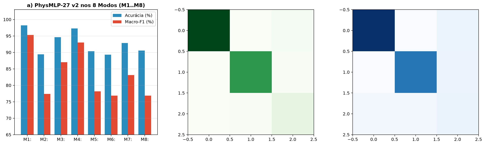
