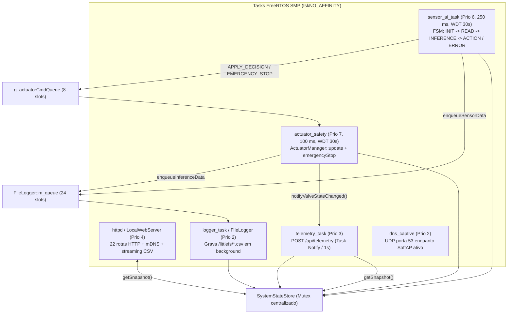
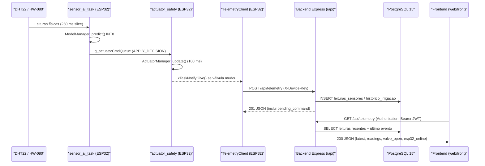

# 03 — Pontos de Execução e Fluxos Ponta a Ponta

Este documento mapeia todos os **pontos de entrada (*entrypoints*)** executáveis do repositório, a topologia de execução em tempo real do firmware **FreeRTOS SMP**, o fluxo ponta a ponta entre hardware e nuvem, e os comandos de build, testes e CI.

---

## 1. Mapa Geral de Pontos de Entrada (Entrypoints)

| Camada | Ponto de Entrada | Função |
| :--- | :--- | :--- |
| **Firmware ESP32** | `embedded/src/main.cpp` (`app_main`) | Bootstrap de hardware, NVS, LittleFS, rede, HTTP, telemetria e criação das tasks SMP. |
| **IA — Treino v2** | `ai-model/scripts/train_tinyml_v2.py` | Treino `PhysMLP-27`, validação dupla, quantização INT8, exportação de `model_data.h` e *fine-tuning*. |
| **IA — Benchmark** | `ai-model/scripts/benchmark_architectures.py` | Benchmark comparativo de 10 arquiteturas nos 8 modos de contexto + `GroupSplit`. |
| **IA — Gráficos** | `ai-model/scripts/generate_plots.py` | Geração das 12 pranchas gráficas em `ai-model/output/figures/`. |
| **Build Web Embarcada** | `embedded/scripts/gzip_data.py` | Hook `pre:buildfs` que comprime `embedded/view/index.html` para `embedded/data/index.html.gz`. |
| **Backend REST** | `web/back/server.js` | Inicialização Express 5, `validateEnv()`, CORS, rotas `/api/auth` e `/api`, healthcheck `SELECT 1`. |
| **Frontend Web** | `web/front/index.html` + `web/front/c.js` | SPA servida estaticamente; valida sessão em `DOMContentLoaded` via `GET /api/auth/me`. |
| **Orquestração** | `docker-compose.yml` | Sobe `db` (PostgreSQL 15 com `healthcheck`) e `backend` (porta `8080`). |
| **Testes Firmware** | `embedded/test/run_host_tests.sh` | Compila e executa 3 suítes Unity em host (`g++ -std=gnu++17` + stubs). |
| **Testes Backend** | `web/back/tests/api.test.js` | Executado via `npm test` (`node --test tests/*.test.js`). |
| **CI** | `.github/workflows/ci.yml` | Executa `npm ci`, `npm test` e `node --check server.js` em `push`/`pull_request`. |

---

## 2. Execução do Firmware ESP32 (`embedded/src/main.cpp`)

### 2.1. Ordem Determinística de Inicialização (`app_main`)
1. `g_configMgr.init()` — Inicializa NVS (`"irrig_cfg"`, `schemaVersion = 2`) e sanitiza parâmetros.
2. `g_actuatorMgr.init()` — **Fecha fisicamente o relé antes de qualquer outra operação** (`RELAY_ACTIVE_LOW`).
3. `xQueueCreate(...)` — Cria `g_actuatorCmdQueue` (`8` slots de `ActuatorCommand`).
4. `g_fileLogger.init()` — Monta LittleFS (`/littlefs` na partição `spiffs`), garante cabeçalhos CSV e inicia `logger_task`.
5. `g_sensorsMgr.init()` — Configura DHT22 (GPIO 5) e ADC1_CH4 (GPIO 32) com calibração eFuse.
6. `g_networkMgr.init()` — Inicia `esp_wifi` assíncrono (STA ou SoftAP) e SNTP (`BRT3`).
7. `g_webServer.start()` — Inicia `esp_http_server` (22 rotas) e mDNS (`irrigacao.local`).
8. `g_telemetryClient.start()` — Inicia `telemetry_task` (`tskNO_AFFINITY`, prio `3`).
9. `xTaskCreatePinnedToCore(actuatorSafetyTask, ..., tskNO_AFFINITY)` — Prio `7`, stack `4096 B`.
10. `xTaskCreatePinnedToCore(sensorAiTask, ..., tskNO_AFFINITY)` — Prio `6`, stack `8192 B`.

### 2.2. Topologia FreeRTOS SMP (`tskNO_AFFINITY`)



### 2.3. Máquina de Estados (FSM) e Camadas *Fail-Safe*
* **`INIT`:** Carrega `ModelManager` (`esp-tflite-micro` INT8, arena `12 KB`) e executa `runGoldenSelfTest()` (`6` vetores). Falha $\rightarrow$ `ERROR`.
* **`READ_SENSORS`:** Lê DHT22 e mediana de 10 amostras ADC1 do HW-080. Rejeita sentinelas (`-999`, `255`, curto `<= 10`, fio solto `>= 4090`). Após `3` falhas seguidas $\rightarrow$ `ERROR`.
* **`RUN_INFERENCE`:** Codifica `27` features (`encodeFeatures27`) e executa `ModelManager::predict()`. Aplica fallback térmico se `temp >= 32 °C` e `soil >= 65%` com `P(2) >= thermalStressThreshold`.
* **`EXECUTE_ACTION`:** Envia `ActuatorCommand` para `g_actuatorCmdQueue`. Na `actuator_safety`, abertura exige `2` confirmações seguidas (*debounce*), enquanto fechamento, `maxIrrigationMs` e `cooldownMs` são supervisionados a cada `100 ms`.
* **`ERROR`:** Envia `EMERGENCY_STOP` (fecha válvula imediatamente + LED de erro) e tenta recuperação automática no próximo intervalo.

---

## 3. Fluxo Ponta a Ponta (Hardware $\leftrightarrow$ Backend $\leftrightarrow$ Frontend)



> **Observação de Implementação Atual:** `telemetryService.js` já devolve `pending_command` na resposta de `POST /api/telemetry` quando há acionamento manual via dashboard (`POST /api/irrigation/manual`), porém `TelemetryClient::publishSnapshot()` ainda não faz o *parse* desse campo para comandar o `ActuatorManager`.

---

## 4. Pontos de Execução de Build, Testes e CI

```bash
# 1. Backend + PostgreSQL (Docker)
docker compose up -d

# 2. Testes unitários do Backend (Node.js)
cd web/back && npm test && node --check server.js

# 3. Testes unitários do Firmware em Host (Unity C++ + Stubs)
bash embedded/test/run_host_tests.sh

# 4. Build e Upload do Firmware (PlatformIO + ESP-IDF)
cd embedded
pio run
pio run -t buildfs
pio run -t upload && pio run -t uploadfs

# 5. Pipeline TinyML (Treino / Fine-Tuning)
cd ai-model
python3 scripts/train_tinyml_v2.py
python3 scripts/train_tinyml_v2.py --field-inferences caminho/inference.csv --epochs-ft 15 --lr-ft 5e-4
```
