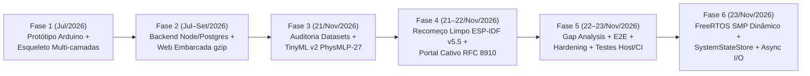

# Série de Evolução, Arquitetura e Execução — Sistema de Irrigação Inteligente (PIBEX 2026)

> **Escopo:** Mapeamento completo da evolução do repositório (`84` commits entre `2026-07-14` e `2026-11-23`, intervalo `96e0cc2..3c5ac4c`), cobrindo etapas de desenvolvimento, viradas de arquitetura, pontos de execução, mapa de implementação e maturidade atual.  
> **Contribuidores registrados no histórico:** `Victor Giuliano` (`victorgiuliano2162`) e `Ricardo Fragoso`.

---

## Índice da Série (`docs/evolution/`)

| Documento | Foco Principal |
| :--- | :--- |
| **[01-timeline-and-phases.md](01-timeline-and-phases.md)** | Linha do tempo cronológica, **6 fases de desenvolvimento**, entregas e tabela de commits representativos (`96e0cc2..3c5ac4c`). |
| **[02-architectural-pivots.md](02-architectural-pivots.md)** | **10 Viradas de Arquitetura (ADRs retrospectivos)**: problema/gatilho, decisão adotada, antes vs. depois e impacto mensurado. |
| **[03-execution-points-and-flows.md](03-execution-points-and-flows.md)** | Pontos de entrada (*entrypoints*), topologia **FreeRTOS SMP**, FSM, endpoints HTTP/REST, fluxo ponta a ponta e comandos de build/testes/CI. |
| **[04-implementation-map.md](04-implementation-map.md)** | Inventário técnico por camada (`embedded/`, `ai-model/`, `web/back/`, `web/front/`, Docker/CI), contratos e mecanismos de segurança. |
| **[05-maturity-gaps-and-roadmap.md](05-maturity-gaps-and-roadmap.md)** | Matriz de maturidade, auditoria de fechamento dos **21 gaps** (`gap-analysis.md`), dívidas técnicas atuais e roadmap priorizado. |

---

## Macro-Evolução das Fases e Viradas Arquiteturais

---

## Quadro-Síntese do Ecossistema Atual (`3c5ac4c`)

| Camada | Stack Principal | Métricas e Estado Verificado |
| :--- | :--- | :--- |
| **IA Embarcada (`ai-model/`)** | Python 3, TensorFlow/Keras, Scikit-learn, TFLite INT8 | Modelo **`PhysMLP-27` Full INT8 (`5.480 B`)**, `27` features (sensores + One-Hot + 4 psicrométricas VPD), `98,20%` Acc M1 (`97,43%` GroupSplit), `90,54%` M8, `98,50%` concordância F32/INT8, `6` *Golden Vectors*. |
| **Firmware (`embedded/`)** | PlatformIO + **ESP-IDF v5.5.4**, C++17, **FreeRTOS SMP** | `6` tasks com `tskNO_AFFINITY` (`actuator_safety`, `sensor_ai_task`, `httpd`, `telemetry_task`, `logger_task`, `dns_captive`), **`51.152 B` RAM estática (`15,6%`)**, **`944.247 B` Flash `app0` (`53,4%`)**, LittleFS `512 KB`, NVS schema v2, `3` suítes Unity em host. |
| **Backend (`web/back/`)** | Node.js, Express 5, PostgreSQL 15, JWT, `bcryptjs` | Arquitetura em camadas (`routes` -> `middlewares` -> `controllers` -> `services` -> `models`), JWT + `X-Device-Key` + rate limit + CORS configurável, `7` testes em `node --test`. |
| **Frontend (`web/front/`)** | HTML5, Tailwind CSS (CDN), JavaScript vanilla | SPA com login/cadastro, validação de sessão via `/api/auth/me`, polling controlado de telemetria real, histórico e acionamento manual. |
| **Infraestrutura & CI** | Docker Compose, GitHub Actions | PostgreSQL 15 com `healthcheck` + serviço `backend`; CI executando `npm test` e `node --check server.js` em `push`/`pull_request`. |

---

## Documentação Relacionada em `docs/`

* **Arquitetura:** [firmware-espidf.md](../architecture/firmware-espidf.md) · [embedded-web-api.md](../architecture/embedded-web-api.md)
* **IA & TinyML:** [tinyml-pipeline.md](../ai/tinyml-pipeline.md) · [audit-and-benchmark.md](../ai/audit-and-benchmark.md)
* **Pesquisa & Dados:** [datasets-summary.md](../research/datasets-summary.md) · [datasets-evaluation.md](../research/datasets-evaluation.md) · [articles.md](../research/articles.md)
* **Planejamento & Sínteses:** [action-plan.md](../planning/action-plan.md) · [todo.md](../planning/todo.md) · [checklists.md](../planning/checklists.md) · [gap-analysis.md](../gap-analysis.md) · [resumo-ia-e-firmware.md](../resumo-ia-e-firmware.md)
